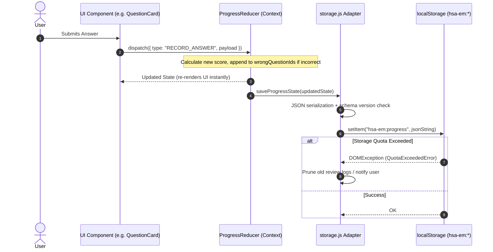
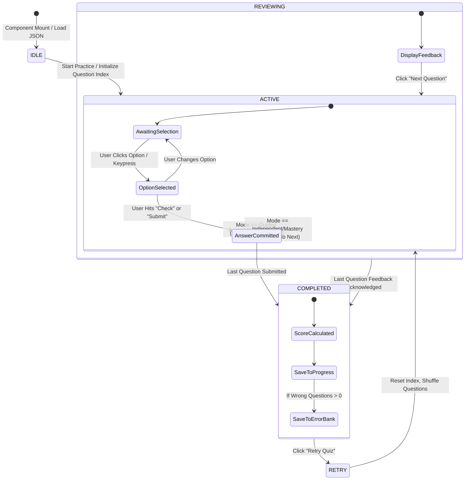
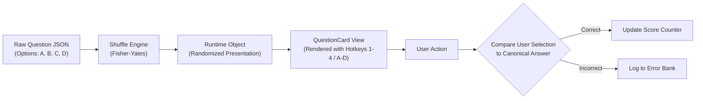

# HSA EnglishMaster — Technical & Design Architecture

| Document Metadata | Details |
|---|---|
| **Document ID** | HSA-DOC-004 |
| **Document Title** | Technical & Design Architecture Specification |
| **Project** | HSA EnglishMaster (Rajasthan High Court System Assistant Exam) |
| **Phase** | Phase 00 — Research & Architecture Planning |
| **Status** | Draft |
| **Version** | 1.0.0 |
| **Date** | 2026-10-20 |
| **Author** | System Architecture & Planning Agent |
| **Target Audience** | Engineering Team, Content Architects, UI/UX Designers |

---

## 1. Executive Summary & Document Overview

The **HSA EnglishMaster** application is a focused, high-efficacy English learning and exam preparation platform engineered specifically for candidates preparing for the Rajasthan High Court System Assistant (HSA) competitive examination. 

The core mission of the platform is to transform dry, rule-heavy syllabus topics (e.g., Tenses, Voice, Narration, Prepositions, Phrasal Verbs) into an interactive, visually structured, and mastery-driven learning experience. To achieve maximum responsiveness, zero operational friction, and full offline reliability, the application is architected as a **pure client-side single-page application (SPA)** with bundled structured content, declarative practice state machines, and local persistence.

This document establishes the end-to-end technical foundation, component hierarchies, content schema definitions, data persistence strategies, practice engine lifecycles, and design principles governing Phase 01 implementation and all subsequent lesson development.

---

## 2. Technical Architecture Overview

### 2.1 Technology Stack

```
+-----------------------------------------------------------------------------------+
|                                  USER INTERFACE                                   |
|  React 18+  *  Tailwind CSS v4  *  Lucide Icons  *  Custom SVG Graphic Components  |
+-----------------------------------------------------------------------------------+
|                                 APPLICATION LAYER                                 |
|      React Router v6+ (Client Routing)   *   Context + useReducer State Hub       |
|      Practice Engine (FSM)               *   Custom Hooks (useProgress, useQuiz)  |
+-----------------------------------------------------------------------------------+
|                                    DATA LAYER                                     |
|  Bundled MDX (Content)   *   JSON Data (Rules/Quizzes)   *   localStorage Adapter |
+-----------------------------------------------------------------------------------+
|                                 BUILD & TOOLING                                   |
|             Vite 5+  *  ESLint  *  PostCSS  *  @mdx-js/rollup Plugin              |
+-----------------------------------------------------------------------------------+
```

| Layer | Technology | Version | Purpose & Strategic Rationale |
|---|---|---|---|
| **UI Framework** | React | 18.3+ | Component-driven model fits the reusable lesson template pattern; declarative UI handles practice state machines seamlessly. |
| **Build Tool** | Vite | 5.x+ | Lightning-fast Hot Module Replacement (HMR), sub-second cold starts, optimized production ES module bundling. |
| **Styling** | Tailwind CSS | v4.0 | Next-generation CSS framework offering utility-first ergonomics, zero CSS runtime overhead, and unified design token variables. |
| **Content Engine** | MDX (@mdx-js/rollup) | 3.x+ | Blends GitHub-flavored Markdown for long-form study texts with directly embeddable interactive React widgets. |
| **Structured Data** | JSON | Standard | Strict schemas for question banks, rule formulas, common mistakes, and syllabus metadata. |
| **State Management**| React Context + `useReducer` | Built-in | Centralized, deterministic unidirectional state management without heavy third-party state libraries. |
| **Client Routing** | React Router | v6.x+ | Client-side routing with route guards, dynamic `:lessonId` params, and deep-linkable section anchors. |
| **Persistence** | LocalStorage API | Web Standard | 100% offline persistence for lesson completion, quiz attempt logs, user preferences, and mistake tracking. |
| **Iconography** | Lucide React | Latest | Clean, consistent, lightweight SVG icon suite for desktop-grade UI controls. |

### 2.2 Core Architecture Principles

1. **Separation of Concerns: Content $\rightarrow$ Data Layer $\rightarrow$ UI Engine**
   Content creators write pedagogical materials in MDX and JSON without touching React rendering logic. The application treats content as typed, schema-validated data that feeds into modular UI components.
2. **The Reusable Lesson Template Pattern**
   Every lesson—from L01 (*Tenses Architecture*) through L15 (*Advanced Idioms*)—shares an identical structural harness (`LessonTemplate`). Adding a new lesson requires zero changes to core component code; only content files and syllabus manifests are registered.
3. **Progressive Disclosure & Component-Level Code Splitting**
   Only the active lesson and active section are hydrated and rendered into the DOM. Heavy visual diagrams and assessment engines mount dynamically on demand, keeping memory pressure low and navigation instantaneous.
4. **Offline-Capable & Self-Contained Deployment**
   All curriculum documents, rule cards, diagrams, and question sets are pre-compiled and bundled at build time. The entire application operates without network dependencies, external APIs, or database connections.
5. **Deterministic State Progression (Finite State Machines)**
   All interactive quizzes, practice sessions, and mastery tests follow explicit finite state machines. Impossible state combinations (e.g., submitting an answer while reviewing feedback) are structurally prevented at the state reducer level.

---

## 3. Project Structure

The project adopts a domain-driven, modular directory organization designed for developer productivity, clear boundaries, and clean scalability.

```
hsa-englishmaster/
├── public/
│   ├── favicon.svg                  # Application brand mark
│   └── assets/                      # Static brand assets, fonts, reference PDFs
├── src/
│   ├── app/
│   │   ├── App.jsx                  # Top-level shell with layout wrappers & routing
│   │   ├── routes.jsx               # Declarative route configuration
│   │   └── providers.jsx            # Composite context providers (Progress, Settings, UI)
│   ├── components/
│   │   ├── layout/                  # Global structural layout components
│   │   │   ├── AppShell.jsx         # Outer app frame (Sidebar + Main Viewport)
│   │   │   ├── AppHeader.jsx        # Breadcrumbs, quick stats, settings trigger
│   │   │   ├── AppSidebar.jsx       # Global syllabus drawer, syllabus progress meters
│   │   │   └── AppFooter.jsx        # Version stamp and system status
│   │   ├── lesson/                  # Lesson-specific structural components
│   │   │   ├── LessonPage.jsx       # Master orchestrator for route /lesson/:lessonId
│   │   │   ├── LessonHeader.jsx     # Lesson title, badges, estimated time, tabs
│   │   │   ├── LessonSidebar.jsx    # 9-section step navigation & completion markers
│   │   │   ├── LessonFooter.jsx     # Previous/Next step transition controls
│   │   │   ├── StudyDocument.jsx    # MDX container with custom typography styling
│   │   │   ├── RuleCard.jsx         # Interactive syntax formula cards & quick toggles
│   │   │   ├── WorkedExamples.jsx   # Deconstructed sentence analysis view
│   │   │   ├── CommonMistakes.jsx   # Wrong vs. Right comparative callout cards
│   │   │   └── ErrorReview.jsx      # Lesson-specific mistake review & retry launcher
│   │   ├── practice/                # Quiz and testing engine components
│   │   │   ├── PracticeEngine.jsx   # Core quiz controller (manages FSM & question flow)
│   │   │   ├── QuestionCard.jsx     # Prompt display, question metadata, tags
│   │   │   ├── OptionList.jsx       # Single-select option list with state styling
│   │   │   ├── OptionItem.jsx       # Individual choice button with keyboard shortcut
│   │   │   ├── FeedbackPanel.jsx    # Instant feedback drawer with rule link & notes
│   │   │   ├── ScoreSummary.jsx     # Result breakdown, accuracy %, review list
│   │   │   ├── TimerDisplay.jsx     # Countdown/stopwatch component for mastery mode
│   │   │   └── QuestionProgress.jsx # Segmented progress bar & jump-to-question pills
│   │   ├── common/                  # Atomic reusable UI design system primitives
│   │   │   ├── Button.jsx           # Standard buttons (primary, secondary, subtle, danger)
│   │   │   ├── Card.jsx             # Surface panel containers with elevation variants
│   │   │   ├── ProgressBar.jsx      # Linear and circular progress indicators
│   │   │   ├── Badge.jsx            # Topic, difficulty, and status badges
│   │   │   ├── Callout.jsx          # Alert boxes (Note, Important, Warning, Exam Tip)
│   │   │   ├── Modal.jsx            # Accessible dialog overlays
│   │   │   └── Tooltip.jsx          # Lightweight hover information triggers
│   │   └── visuals/                 # Domain-specific interactive grammar graphics
│   │       ├── TenseGrid.jsx        # 12-Tense Matrix with aspect/time coordinates
│   │       ├── TimelineDiagram.jsx  # Past-Present-Future temporal axis visualizer
│   │       ├── BranchingFlow.jsx    # Decision tree visualizer for rule selection
│   │       └── SentenceTree.jsx     # Syntactic structure diagramming component
│   ├── content/
│   │   ├── syllabus.json            # Master syllabus manifest & lesson index
│   │   └── lessons/
│   │       ├── L01/                 # Lesson 01: Tenses Architecture & Time Markers
│   │       │   ├── metadata.json    # Lesson configuration, section index, objectives
│   │       │   ├── study-document.mdx# Long-form pedagogical theory & explanations
│   │       │   ├── rule-cards.json  # Structured grammar formulas & anchor rules
│   │       │   ├── examples.json    # Annotated worked examples with exam callouts
│   │       │   ├── mistakes.json    # High-frequency traps with diagnostics
│   │       │   └── questions/
│   │       │       ├── guided-practice.json       # Scaffolded beginner practice
│   │       │       ├── independent-practice.json  # Medium exam-style practice
│   │       │       └── mastery-assessment.json    # Exam-grade timed mastery test
│   │       ├── L02/                 # Lesson 02: Voice Architecture (Placeholder)
│   │       └── ...                  # Subsequent lessons up to L15
│   ├── hooks/                       # Custom application hooks
│   │   ├── useLesson.js             # Active lesson data loader, section navigator
│   │   ├── useQuiz.js               # Practice Engine state machine manager
│   │   ├── useProgress.js           # Read/write hook for user mastery & completion
│   │   ├── useErrorBank.js          # Mistake tracking, filtering, and remediation
│   │   └── useKeyboardShortcut.js   # Hotkeys for option selection (A, B, C, D, Enter)
│   ├── context/
│   │   ├── ProgressContext.jsx      # Global progress, completion states, error bank
│   │   ├── LessonContext.jsx        # Active lesson runtime context
│   │   └── SettingsContext.jsx      # User preferences (timer on/off, font scale)
│   ├── utils/
│   │   ├── storage.js               # LocalStorage wrapper with error handling & versioning
│   │   ├── scoring.js               # Percentage calculations, mastery grading thresholds
│   │   ├── shuffle.js               # Deterministic / seedable array randomization
│   │   └── timeFormat.js            # Seconds to MM:SS formatting utilities
│   └── styles/
│       ├── tailwind.css             # Tailwind v4 theme configuration & base layers
│       └── typography.css           # Custom styling for rendered MDX prose
├── docs/                            # Project specifications & architecture planning
│   ├── project-brief.md             # High-level vision & syllabus mapping
│   ├── curriculum-roadmap.md        # Master 15-lesson topic sequence
│   ├── pedagogical-framework.md     # 9-step learning methodology & question specs
│   └── architecture-spec.md         # This technical specification
├── index.html                       # Single-page application root HTML
├── tailwind.config.js               # Tailwind styling definitions (if required by setup)
├── vite.config.js                   # Vite configuration with MDX plugin integration
├── package.json                     # Project manifest and scripts
└── README.md                        # Quickstart and developer documentation
```

---

## 4. Content Architecture

### 4.1 Lesson Metadata Schema (`metadata.json`)

Each lesson directory contains a `metadata.json` file that controls how the lesson is rendered, navigated, and validated against prerequisites.

```json
{
  "$schema": "http://json-schema.org/draft-07/schema#",
  "id": "L01",
  "title": "Tenses Architecture & Time Markers",
  "subtitle": "Master the 12-tense matrix, temporal anchors, and sequence rules",
  "syllabusTopicId": "ST01",
  "syllabusTopicName": "Tenses/Sequences of Tenses",
  "partOf": "1 of 3",
  "status": "active",
  "order": 1,
  "prerequisites": [],
  "estimatedMinutes": 90,
  "difficulty": "foundational",
  "targetQuestionsCount": 47,
  "learningObjectives": [
    "Identify and construct all 12 English tense structures accurately",
    "Recognize definitive time markers and bind them to their required tense",
    "Resolve complex past-before-past and future contingency sequence traps",
    "Achieve >= 80% accuracy on High Court-level tense identification items"
  ],
  "sections": [
    { "id": "intro", "type": "introduction", "title": "Welcome & Objectives", "estimatedMinutes": 5 },
    { "id": "study", "type": "study-document", "title": "Tenses Architecture", "estimatedMinutes": 25 },
    { "id": "rules", "type": "rule-cards", "title": "Formula Reference", "estimatedMinutes": 15 },
    { "id": "examples", "type": "worked-examples", "title": "Worked Examples", "estimatedMinutes": 10 },
    { "id": "mistakes", "type": "common-mistakes", "title": "Common Mistakes", "estimatedMinutes": 10 },
    { "id": "guided", "type": "guided-practice", "title": "Guided Practice", "estimatedMinutes": 10 },
    { "id": "independent", "type": "independent-practice", "title": "Independent Practice", "estimatedMinutes": 15 },
    { "id": "mastery", "type": "mastery-assessment", "title": "Mastery Assessment", "estimatedMinutes": 15 },
    { "id": "review", "type": "error-review", "title": "Review & Error Bank", "estimatedMinutes": 5 }
  ]
}
```

#### Metadata Field Specification

| Field Name | Type | Allowed Values / Format | Description |
|---|---|---|---|
| `id` | String | Format: `^L(0[1-9]\|1[0-5])$` (e.g. `L01`) | Unique immutable lesson identifier. |
| `title` | String | 10 to 80 chars | Official lesson title shown across headers and lists. |
| `syllabusTopicId` | String | e.g., `ST01` to `ST08` | Direct foreign key referencing official syllabus topic. |
| `status` | String | `"active"` \| `"locked"` \| `"coming-soon"` | Availability state governing route access and UI display. |
| `difficulty` | String | `"foundational"` \| `"intermediate"` \| `"advanced"` | Conceptual weight of the module. |
| `sections` | Array[Object] | Ordered list of 9 section objects | Defines sequence, type, and navigation flow within the lesson. |
| `sections[].type` | String | Enum of 9 section types | Determines which React container component is mounted. |

### 4.2 Syllabus Index Schema (`syllabus.json`)

The global `syllabus.json` file links the official Rajasthan High Court syllabus topics to specific lessons and sets global progression states.

```json
{
  "curriculumVersion": "2026.1",
  "examName": "Rajasthan High Court System Assistant Examination",
  "subject": "General English",
  "totalLessons": 15,
  "syllabusTopics": [
    {
      "id": "ST01",
      "name": "Tenses/Sequences of Tenses",
      "weightageEstimate": "15-20% of English Section",
      "lessons": ["L01", "L02", "L03"]
    },
    {
      "id": "ST02",
      "name": "Voice: Active and Passive",
      "weightageEstimate": "12-15% of English Section",
      "lessons": ["L04", "L05"]
    },
    {
      "id": "ST03",
      "name": "Narration: Direct and Indirect",
      "weightageEstimate": "12-15% of English Section",
      "lessons": ["L06", "L07"]
    },
    {
      "id": "ST04",
      "name": "Transformation of Sentences",
      "weightageEstimate": "10-12% of English Section",
      "lessons": ["L08", "L09"]
    },
    {
      "id": "ST05",
      "name": "Articles and Determiners",
      "weightageEstimate": "8-10% of English Section",
      "lessons": ["L10"]
    },
    {
      "id": "ST06",
      "name": "Prepositions",
      "weightageEstimate": "10-12% of English Section",
      "lessons": ["L11", "L12"]
    },
    {
      "id": "ST07",
      "name": "Correction of Sentences / Subject-Verb Agreement",
      "weightageEstimate": "12-15% of English Section",
      "lessons": ["L13"]
    },
    {
      "id": "ST08",
      "name": "Vocabulary, Idioms, Phrasal Verbs & One-Word Substitutes",
      "weightageEstimate": "15-18% of English Section",
      "lessons": ["L14", "L15"]
    }
  ],
  "lessons": [
    { "id": "L01", "title": "Tenses Architecture & Time Markers", "status": "active", "order": 1 },
    { "id": "L02", "title": "Sequence of Tenses & Conditionals", "status": "coming-soon", "order": 2 },
    { "id": "L03", "title": "Advanced Tense Traps & Exam Exceptions", "status": "locked", "order": 3 },
    { "id": "L04", "title": "Active & Passive Voice: Fundamental Conversions", "status": "locked", "order": 4 },
    { "id": "L05", "title": "Advanced Passive: Imperatives & Prepositional Verbs", "status": "locked", "order": 5 }
  ]
}
```

### 4.3 Lesson Status Semantics

```
               [ User Views Syllabus ]
                          │
         ┌────────────────┼────────────────┐
         ▼                ▼                ▼
     [ active ]     [ coming-soon ]    [ locked ]
         │                │                │
         ▼                ▼                ▼
  - Fully accessible - Tagged "In Dev"  - Greyed out
  - Route enabled   - Preview modal    - Lock icon
  - Full practice   - Route blocked    - Requires prerequisite
```

* **`active`**: Fully authored, peer-reviewed, and interactive. All routes, questions, and practice engines are operational.
* **`coming-soon`**: Content authored or under active review; UI renders a preview card highlighting syllabus coverage and expected release. Access is non-interactive.
* **`locked`**: Placeholder entry for curriculum completeness. Displayed in greyed-out visual state with lock icon. If prerequisites are defined, unlocks when prerequisites achieve `"mastered"` or `"completed"` status.

### 4.4 Question Bank Schema (`questions/*.json`)

Every question in the app adheres to a unified schema supporting multiple choice questions (MCQ), sentence completion, error identification, and transformation tasks.

```json
{
  "lessonId": "L01",
  "stage": "guided-practice",
  "questions": [
    {
      "id": "L01-GP-001",
      "type": "mcq",
      "prompt": "She usually _______ her office at 9:00 AM, but today she _______ from home.",
      "context": "Time marker analysis: 'usually' vs. 'today'",
      "options": [
        { "id": "A", "text": "leaves; is working" },
        { "id": "B", "text": "is leaving; works" },
        { "id": "C", "text": "leaves; works" },
        { "id": "D", "text": "has left; is working" }
      ],
      "correctAnswer": "A",
      "ruleRef": "RULE-L01-01",
      "difficulty": "foundational",
      "tags": ["simple-present", "present-continuous", "habitual-vs-temporary"],
      "explanation": {
        "summary": "Option A is correct.",
        "breakdown": "The adverb 'usually' indicates a habitual present action requiring the Simple Present tense ('leaves'). The contrastive time marker 'today' signals an ongoing, temporary departure from habit requiring the Present Continuous tense ('is working').",
        "trapAlert": "Option C mistakenly treats the temporary action 'today' as a routine habit."
      },
      "hint": "Check the contrasting time markers: which word signals a routine, and which one signals today's temporary state?"
    }
  ]
}
```

---

## 5. Progress Persistence Architecture

### 5.1 Storage Model & Key Namespacing

To eliminate collisions and maintain a clean schema lifecycle, all client-side state is stored under an explicit prefix: `hsa-em:*`.

```
+─────────────────────────────────────────────────────────────+
|                    Browser LocalStorage                     |
+─────────────────────────────────────────────────────────────+
  ├── hsa-em:progress    ── Main curriculum progress & scores
  ├── hsa-em:errors      ── Global mistake log & error bank
  └── hsa-em:settings    ── UI, accessibility & timer options
```

The storage layer is encapsulated inside `src/utils/storage.js`. Direct calls to `window.localStorage` are forbidden across components; all reads/writes pass through type-safe, error-resilient wrapper functions that validate JSON and handle storage quota exceptions gracefully.

### 5.2 Progress Schema (`hsa-em:progress`)

```json
{
  "version": 1,
  "lastUpdated": "2026-10-20T14:00:00Z",
  "overallStats": {
    "lessonsCompleted": 1,
    "lessonsMastered": 0,
    "totalPracticeQuestionsAnswered": 47,
    "overallAccuracyPercentage": 82.9
  },
  "lessons": {
    "L01": {
      "status": "in-progress",
      "currentSection": "independent",
      "sectionsCompleted": ["intro", "study", "rules", "examples", "mistakes", "guided"],
      "lastAccessedAt": "2026-10-20T14:25:12Z",
      "guidedPractice": {
        "completed": true,
        "score": 10,
        "total": 12,
        "accuracy": 83.3,
        "attempts": 1,
        "wrongQuestionIds": ["L01-GP-003", "L01-GP-009"],
        "completedAt": "2026-10-20T13:45:00Z"
      },
      "independentPractice": {
        "completed": false,
        "score": 0,
        "total": 20,
        "accuracy": 0,
        "attempts": 0,
        "wrongQuestionIds": [],
        "completedAt": null
      },
      "masteryAssessment": {
        "completed": false,
        "bestScore": 0,
        "total": 15,
        "accuracy": 0,
        "attempts": 0,
        "lastAttemptDate": null,
        "passed": false
      }
    }
  }
}
```

### 5.3 Error Bank Schema (`hsa-em:errors`)

The Error Bank records every incorrect submission across all practice modes, powering the dedicated remediation review engine.

```json
{
  "version": 1,
  "errors": [
    {
      "errorId": "ERR-20261020-001",
      "questionId": "L01-GP-003",
      "lessonId": "L01",
      "stage": "guided-practice",
      "prompt": "By the time the magistrate arrived, the suspect _______ .",
      "selectedAnswer": "B",
      "correctAnswer": "C",
      "ruleRef": "RULE-L01-04",
      "timestamp": "2026-10-20T13:35:10Z",
      "reviewed": false,
      "retryCount": 0,
      "lastRetrySuccess": false
    }
  ]
}
```

### 5.4 User Preferences Schema (`hsa-em:settings`)

```json
{
  "version": 1,
  "theme": "light",
  "fontSize": "normal",
  "soundEffectsEnabled": true,
  "autoAdvanceOnCorrect": false,
  "showTimerInMastery": true,
  "keyboardShortcutsEnabled": true
}
```

### 5.5 State Synchronization & Persistence Lifecycle



---

## 6. Lesson Template Architecture

### 6.1 Reusable Lesson Template Pattern

All 15 curriculum lessons execute within a unified, high-performance container hierarchy. The UI container provides uniform breadcrumbs, persistent navigation, section progress markers, and keyboard hotkeys.

```
LessonPage (Route: /lesson/:lessonId)
│
├── LessonHeader
│   ├── Breadcrumb (Syllabus > Topic > Lesson)
│   ├── Title & Subtitle Badge
│   ├── Time Indicator & Estimated Duration
│   └── Section Progress Strip (9 Steps)
│
├── Main Viewport Layout (2-Column Grid on Desktop)
│   ├── LessonSidebar (Sticky Column: Width 280px)
│   │   ├── Section 01: Welcome & Objectives  [ completed / active / pending ]
│   │   ├── Section 02: Tenses Architecture   [ completed / active / pending ]
│   │   ├── Section 03: Formula Reference     [ completed / active / pending ]
│   │   ├── Section 04: Worked Examples       [ completed / active / pending ]
│   │   ├── Section 05: Common Mistakes       [ completed / active / pending ]
│   │   ├── Section 06: Guided Practice       [ score: 10/12 ]
│   │   ├── Section 07: Independent Practice  [ score: --/20 ]
│   │   ├── Section 08: Mastery Assessment    [ locked / ready ]
│   │   └── Section 09: Review & Error Bank   [ 2 items pending ]
│   │
│   └── LessonContent (Dynamic Stage Dispatcher)
│       ├── (intro)       ──> IntroductionSection
│       ├── (study)       ──> StudyDocumentSection (MDX renderer)
│       ├── (rules)       ──> RuleCardsSection (Formula grid)
│       ├── (examples)    ──> WorkedExamplesSection
│       ├── (mistakes)    ──> CommonMistakesSection
│       ├── (guided)      ──> GuidedPracticeSection (PracticeEngine)
│       ├── (independent) ──> IndependentPracticeSection (PracticeEngine)
│       ├── (mastery)     ──> MasteryAssessmentSection (PracticeEngine)
│       └── (review)      ──> ErrorReviewSection
│
└── LessonFooter (Sticky Navigation Bar)
    ├── Previous Section Button (or previous lesson)
    ├── Progress Completion Indicator (%)
    └── Next Section Button (handles completion triggers)
```

### 6.2 Component Interface Contracts

Each section component adheres to an explicit interface contract, receiving the active lesson context and dispatch handlers:

```jsx
// Contract for Lesson Content Components
interface LessonSectionProps {
  lessonId: string;
  metadata: LessonMetadata;
  progress: LessonProgress;
  onCompleteSection: (sectionId: string) => void;
  onNavigateSection: (targetSectionId: string) => void;
}
```

### 6.3 Standard 9-Step Pedagogical Workflow

| Step # | Section ID | Type | Primary Pedagogical Purpose | Transition / Pass Criterion |
|---|---|---|---|---|
| 1 | `intro` | Introduction | Orient learner, clarify exam weightage, set explicit goals | "Get Started" click |
| 2 | `study` | Study Document | Deep cognitive acquisition via structured MDX and custom visuals | Mark as read / Scroll threshold |
| 3 | `rules` | Rule Cards | Structural pattern memorization & formula reference | Interacted with cards |
| 4 | `examples` | Worked Examples | Step-by-step cognitive modeling (exam-style items deconstructed) | Viewed all examples |
| 5 | `mistakes` | Common Mistakes | Prevent high-frequency candidate errors & false intuitions | Reviewed traps |
| 6 | `guided` | Guided Practice | Scaffolded application with immediate feedback and rule links | Attempted all items |
| 7 | `independent`| Independent Practice| Exam simulation with delayed feedback & post-quiz review | Completed all items |
| 8 | `mastery` | Mastery Assessment | High-stakes timed certification ($80\%$ threshold to master) | $\ge 80\%$ correct score |
| 9 | `review` | Error Review | Targeted remediation of missed questions in Error Bank | Zero unreviewed errors |

---

## 7. Practice Engine Architecture

### 7.1 Quiz State Machine

The Practice Engine governs all interactive questioning through a strict finite state machine (FSM). This eliminates out-of-order submissions, duplicate scoring, and UI race conditions.



### 7.2 Practice Modes Comparison

The engine adapts its feedback, timing, and score persistence based on the active `mode`:

| Mode Attribute | Guided Practice (`guided`) | Independent Practice (`independent`) | Mastery Assessment (`mastery`) | Error Re-Practice (`remedial`) |
|---|---|---|---|---|
| **Feedback Timing** | **Immediate**: On submit, option highlights green/red, explanation opens | **Deferred**: No feedback during test; full report at completion | **Deferred**: No feedback during test; score & review after final submit | **Immediate**: Immediate explanation to reinforce correct reasoning |
| **Timer** | None (Relaxed learning) | Optional elapsed timer | **Enforced countdown**: 60s per question average | None |
| **Hints Available** | Yes (Collapsible hint button) | No | No | Yes (Shows referenced rule card) |
| **Option Shuffling** | Yes (Prevents position bias) | Yes | Yes | Yes |
| **Error Logging** | Logged to Error Bank on error | Logged to Error Bank on error | Logged to Error Bank on error | Removed from Error Bank on correct retry |
| **Passing Criteria** | Completion (all attempted) | $\ge 70\%$ accuracy recommended | **$\ge 80\%$ score required** for "Mastered" badge | 100% correct resolution of active queue |

### 7.3 Question Rendering & Shuffling Pipeline

To prevent positional memory bias (e.g., "the answer is always C"), options are shuffled using a seeded Fisher-Yates algorithm while maintaining an internal mapping to the canonical correct option ID:



---

## 8. Design Direction (Principles Only)

> [!NOTE]
> Detailed color tokens, typography scales, spacing grids, and component specs will be finalized in **Phase 01: Design System & Prototype**. The principles below establish the mandatory UX constraints and visual guidelines.

### 8.1 Visual Design Principles

1. **Clarity Over Decoration**
   Every visual element, border, divider, and icon must serve an unambiguous pedagogical purpose. Gratuitous animations, confetti celebrations, and gamified clutter are explicitly rejected.
2. **Professional, Exam-Focused Tone**
   The candidate is preparing for a prestigious judicial branch position (High Court). The application’s aesthetic must reflect authority, precision, calm, and academic seriousness—reminiscent of high-caliber legal reference portals.
3. **Consistent Typography & Visual Hierarchy**
   - Headings, grammatical terms, and tense labels must possess distinct visual weights.
   - Formulas and syntax rules must always be rendered in high-contrast monospaced or structured pill formats.
   - Target sentences in questions must be visually distinct from surrounding instructional text.
4. **Purposeful Whitespace & Cognitive Ergonomics**
   Grammar study demands intense mental parsing. Ample whitespace, generous line heights ($1.65+$ for prose), and max reading widths ($65-75\text{ characters}$) minimize visual fatigue during long study sessions.
5. **Desktop-First Layout (1280px+ Optimized)**
   The primary study mode for competitive exam candidates using this tool is desktop or laptop screens. The interface maximizes this screen estate with a comfortable multi-column split: persistent navigation/index on the left, primary study/practice content in the center, and supplementary contextual rule anchors on the right.

### 8.2 When to Use Visuals vs. Tables/Text

| Information Type | Preferred Presentation | Technical Medium | Educational Rationale |
|---|---|---|---|
| **Temporal Relationships** (e.g., Past Perfect vs. Simple Past) | **Timeline Graphic** | SVG / Canvas Component | Time is linear; learners grasp "action completed before another past event" instantaneously along a horizontal axis. |
| **Tense Classification** (12 Tenses) | **2D Coordinate Grid** | React CSS Grid Component | Cross-sections Time (Past/Present/Future) against Aspect (Simple/Continuous/Perfect/Perfect Continuous). |
| **Syntactic Formulas** | **Structured Formula Table** | Styled Markdown / Table | Rigid, exact formula notation ($S + \text{had} + V_3 + O$) requires tabular precision, not pictorial metaphor. |
| **Rule Selection Logic** (e.g., *Since* vs. *For*) | **Branching Flowchart** | Interactive SVG / Flowchart | Visualizes binary decisions (Point of Time vs. Period of Time). |
| **Worked Examples** | **Deconstructed Card** | Component with Colored Highlights | Highlights subject, auxiliary, main verb, and time marker with matching color-coded annotations. |
| **High-Frequency Traps** | **Side-by-Side Comparison Box** | Red/Green Contrast Callout | Immediately trains the eye to differentiate correct usage from common false intuitions. |

### 8.3 Illustration & Graphic Asset Guidelines

* **Pure Vector Graphics (SVG)**: All visual aids are built as responsive SVGs or lightweight CSS/React components. Bitmaps (PNG/JPG) are restricted to photographic references where strictly required.
* **Semantic State Binding**: Visuals must dynamically respond to state. In the `TenseGrid`, hovering or focusing on a tense card highlights its corresponding time marker and rule definition.
* **Strict Accessibility**: Visuals must not rely exclusively on color to convey information. All status markers pair color with unambiguous iconography (e.g., checkmark for correct, cross for incorrect) and provide full ARIA labels.

---

## 9. Future Extensibility

The architecture is deliberately structured to support advanced features in Phase 02+ without breaking schema changes or architectural rewrites:

```
+─────────────────────────────────────────────────────────────────────────────+
|                         Future Feature Roadmap                              |
+─────────────────────────────────────────────────────────────────────────────+
  ├── 1. Centralized Error Bank Dashboard
  │      Aggregate view of all missed questions across all 15 lessons with
  │      filter-by-topic, retry sessions, and mastery remediation flags.
  │
  ├── 2. Rapid Revision & Cheat-Sheet Mode
  │      A high-density study mode stripping away practice questions to render
  │      all rule cards, formulas, and common mistake tables in one printable view.
  │
  ├── 3. Candidate Readiness Analytics
  │      Cross-topic radar chart mapping syllabus mastery, average time per question,
  │      and statistical probability of clearing the HSA exam cutoff.
  │
  ├── 4. Full-Length Timed Mock Examinations
  │      Composite 50-question mock exams sampling across all 8 syllabus topics
  │      under official exam timing constraints (negative marking simulation).
  │
  ├── 5. Spaced Repetition Practice Intervals (Leitner Algorithm)
  │      Automated scheduling reminding candidates to re-test topics at 3-day,
  │      7-day, and 21-day intervals based on historical error rates.
  │
  └── 6. Modular Lesson Ingestion Pipeline
         Adding lessons L02-L15 requires only dropping a new folder into
         `src/content/lessons/` and adding an entry to `syllabus.json`.
```

---

## 10. Technical Decisions Summary & Trade-off Matrix

| Architecture Decision | Chosen Technology / Pattern | Core Rationale | Alternatives Evaluated | Rejection Reason |
|---|---|---|---|---|
| **Core Framework** | **React 18+** | Universal ecosystem, robust component abstractions, optimal for declarative state machines. | Vue 3, Svelte 5 | Smaller component ecosystem for complex interactive grammar visualizations; team familiarity with React. |
| **Application Architecture** | **Client-Side SPA (Static)** | 100% offline capable, instant transitions, zero cloud hosting costs, zero DB maintenance. | Full-Stack (Next.js / Node.js) | Server-side rendering adds deployment overhead, latency, and hosting dependencies unnecessary for a self-contained learning tool. |
| **Build Tooling** | **Vite** | Sub-100ms HMR, native ES modules, lean build configuration with first-class MDX plugin support. | Create React App, Webpack | Webpack/CRA is obsolete, slow cold-starts, cumbersome plugin configuration. |
| **Styling Framework** | **Tailwind CSS v4** | Instant utility-driven composition, compile-time purge, predictable design token variables. | CSS Modules, Styled Components | Styled-components introduce runtime CSS-in-JS performance overhead; CSS modules slow down rapid UI iteration. |
| **Curriculum Content Format** | **MDX + Strict JSON** | MDX enables rich long-form pedagogical text with live interactive React components; JSON ensures rigid typing for questions. | Pure Markdown, Headless CMS | Pure Markdown cannot embed interactive widgets; a CMS requires internet connectivity, APIs, and ongoing maintenance. |
| **State Management** | **Context + `useReducer`** | Built-in, lightweight, zero bundle overhead; `useReducer` enforces deterministic state transitions for quiz machines. | Redux Toolkit, Zustand | Redux Toolkit is excessive boilerplate for a client SPA; Zustand, while clean, introduces external dependencies without added value for this scope. |
| **Client Persistence** | **Browser `localStorage`** | Universal browser support, zero configuration, synchronous reads during initial hydration, ample quota for text data. | IndexedDB, SQLite-WASM | IndexedDB has cumbersome asynchronous APIs; SQLite-WASM adds unnecessary multi-megabyte bundle overhead for simple key-value needs. |
| **Routing** | **React Router v6+** | Industry standard, robust dynamic parameter matching (`:lessonId`, `:sectionId`), deep linking. | TanStack Router, Custom State | TanStack Router is powerful but introduces steep typing overhead; custom routing lacks URL history and bookmarking support. |
| **Content Rendering** | **MDX Compilation** | Rich long-form study text with embedded interactive components (TenseGrid, TimelineDiagram). | Markdown-it, custom parser | Pure Markdown parsers cannot mount dynamic interactive React components inline. |

---

## 11. Appendix: Verification & Acceptance Criteria

Before any lesson or UI module is merged into production, it must fulfill the following technical acceptance criteria derived from this architecture:

1. **Schema Validation**: All lesson `metadata.json`, `rule-cards.json`, and question JSON files must pass schema validation without syntax errors or missing mandatory fields.
2. **Deterministic Practice State**: Quizzes must correctly handle refresh and tab-switching without losing active attempt data or corrupting the Error Bank.
3. **Zero Network Calls**: Running the application in offline mode (Network Disconnected in DevTools) must not produce console errors or degraded functionality.
4. **Layout Responsiveness**: While optimized desktop-first ($1280\text{px}+$), the application must remain legible and navigable without horizontal scrollbars down to tablet widths ($768\text{px}$).
5. **Clean Code & File Links**: All imports must adhere to the defined project directory structure with zero circular dependencies.
