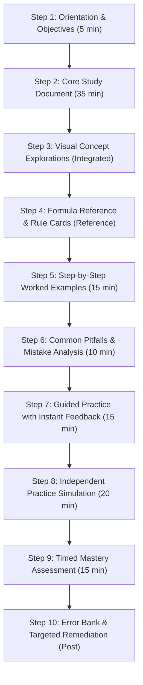
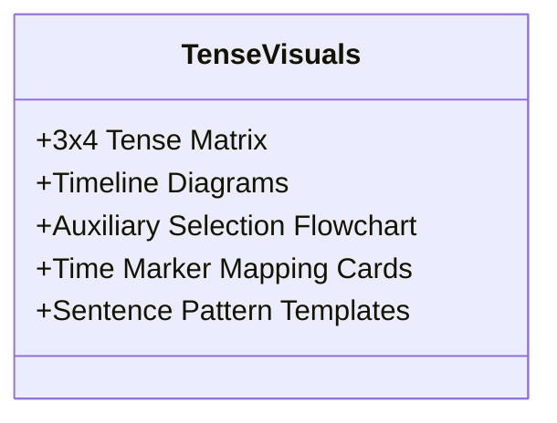
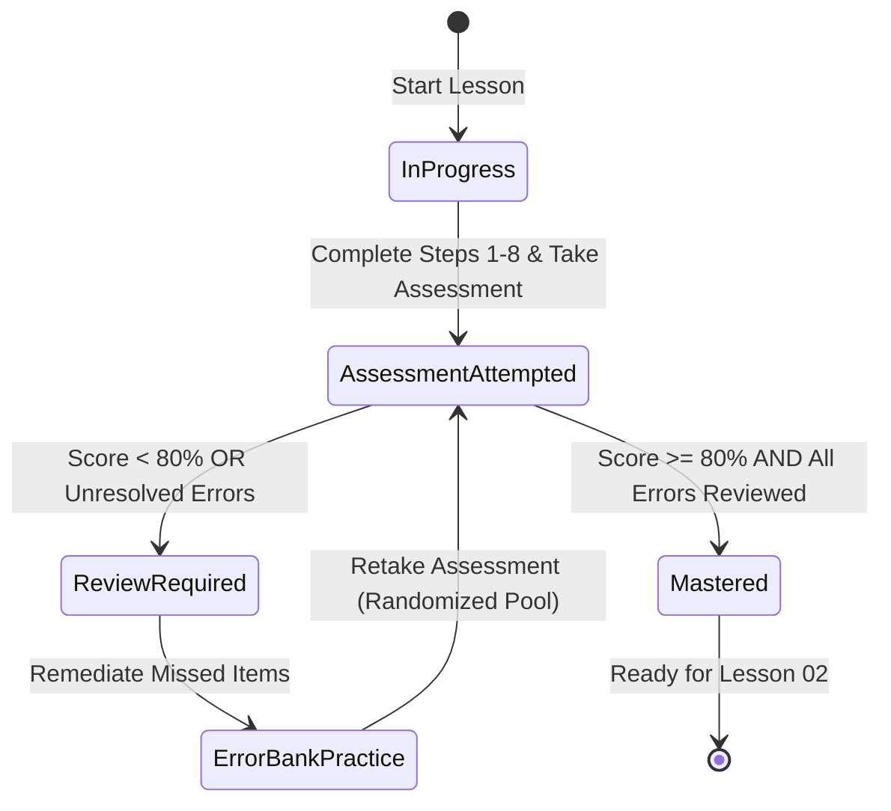

# Lesson 01 Specification — Tenses Architecture & Time Markers

| Metadata Field | Value |
| :--- | :--- |
| **Document Type** | Lesson Specification (Phase 00 Architecture) |
| **Document ID** | SPEC-L01-TENSES-FOUNDATION |
| **Phase** | 00 (Planning & Architecture) |
| **Status** | Draft |
| **Version** | 1.0.0 |
| **Date** | 2026-10-20 |
| **Target Audience** | Content Authors, Curriculum Designers, Frontend Developers, QA Reviewers |

---

## 1. Document Header & Overview

This specification establishes the authoritative design, curricular boundaries, pedagogical sequence, technical schemas, and quality acceptance criteria for **Lesson 01: Tenses Architecture & Time Markers**. 

Lesson 01 serves as the foundational cornerstone for the syllabus topic **"Tenses/Sequences of Tenses"** in the **Rajasthan High Court System Assistant (HSA) English Preparation Suite**. It builds the structural mental model of English verbal grammar (3 Times × 4 Aspects = 12 Tenses), auxiliary verb mechanics, sentence transformations (Positive, Negative, Interrogative), and critical temporal markers (signal words). 

This lesson is engineered to provide learners with an unshakeable base before they encounter complex clause interactions in subsequent lessons.

---

## 2. Lesson Metadata

| Attribute | Specification |
| :--- | :--- |
| **Lesson ID** | `L01` |
| **Title** | Tenses Architecture & Time Markers |
| **Short Title** | Tenses Architecture |
| **Syllabus Category** | Core Grammar Architecture |
| **Syllabus Topic** | Tenses / Sequences of Tenses (Part 1 of 3) |
| **Curriculum Module** | Month 1, Week 1, Day 2 Foundation |
| **Prerequisites** | Basic understanding of English parts of speech (nouns, pronouns, verbs, adjectives, adverbs, prepositions) |
| **Estimated Study Time** | 90 – 120 minutes |
| **Cognitive Difficulty** | Foundational (Level 1 / Level 2 Bloom's Taxonomy) |
| **Target Proficiency** | 100% structural accuracy in identifying and forming all 12 tenses; instant pattern recognition of key time markers in competitive exam MCQs |
| **Content Packaging** | MDX Study Guide + JSON Rule Cards + JSON Examples + Question Bank |

---

## 3. Learning Objectives

By the completion of this lesson, the learner will be able to:

1. **Deconstruct the Dual-Axis Tense Matrix**: Identify and differentiate the three time dimensions (*Past*, *Present*, *Future*) and the four grammatical aspects (*Simple / Indefinite*, *Continuous / Progressive*, *Perfect*, *Perfect Continuous / Progressive*).
2. **Synthesize the 12 Tense Formulas**: Formulate each of the 12 tense structures using correct auxiliary verbs (`do/does/did`, `be: am/is/are/was/were/been/being`, `have: has/have/had`, `will/shall`) combined with the precise primary verb inflection forms ($V_1$, $V_2$, $V_3$, $V_{ing}$, $V_{s/es}$).
3. **Decode & Apply Temporal Time Markers**: Detect and leverage tense-specific signal adverbs/phrases (e.g., *always, usually, yesterday, ago, since, for, already, recently, by the time, next month*) as deterministic markers to deduce the mandatory verb form in fill-in-the-blank and error-spotting questions.
4. **Disambiguate High-Frequency Confusing Tense Pairs**: Distinguish nuances between commonly confused pairs—specifically *Simple Past vs. Present Perfect*, and *Present Simple (Habitual/Timeless) vs. Present Continuous (Temporary/Dynamic)*.
5. **Execute Syntactic Polarity & Structural Shifts**: Construct positive (affirmative), negative, and interrogative (Yes/No and Wh-) sentences across all 12 tenses with zero auxiliary or word-order inversion errors.
6. **Solve Context-Based Competitive Exam MCQs**: Evaluate sentence stems in competitive multiple-choice items, eliminate grammatically discordant options, and select the correct verb form under timed conditions.

---

## 4. Topic Boundaries

To maintain pedagogical clarity, cognitive load management, and strict modularity across the curriculum, the following scope boundaries are enforced:

### 4.1 INCLUDED in Lesson 01

* **Core Conceptualization**: Tense as the mathematical intersection of **Time** (when an event occurs on the real-world timeline) and **Aspect** (how the speaker views the internal temporal contour or completion status of the event).
* **The Complete 3×4 Grid**: Comprehensive formulas, syntactic slots, and usage descriptions for all 12 tenses.
* **Auxiliary Verb System**: Complete mapping of auxiliary verbs (`is/am/are`, `was/were`, `has/have`, `had`, `do/does`, `did`, `will/shall`, `been`, `being`) to their governing tenses and grammatical person/number agreements (singular vs. plural, 1st/2nd/3rd person).
* **Verb Conjugation Architecture**:
  * Base / Infinitive Form ($V_1$)
  * Simple Past Form ($V_2$)
  * Past Participle Form ($V_3$)
  * Present Participle Form ($V_{ing}$)
  * Third-Person Singular Present Form ($V_{s/es}$)
  * Core regular vs. high-frequency irregular verb changes (e.g., *go/went/gone*, *write/wrote/written*, *cut/cut/cut*, *choose/chose/chosen*).
* **Three Syntactic Sentence Patterns**:
  * **Affirmative**: $\text{Subject} + \text{Auxiliary} + \text{Verb Form} + \text{Object/Complement}$
  * **Negative**: $\text{Subject} + \text{Auxiliary} + \text{not} + \text{Verb Form} + \text{Object/Complement}$
  * **Interrogative**: $\text{Auxiliary} + \text{Subject} + \text{Verb Form} + \text{Object/Complement}?$ (plus Wh-word extensions).
* **Deterministic Time Markers (Signal Words)**:
  * Simple Present: *daily, always, usually, often, seldom, rarely, every day/week, twice a year, on Mondays*.
  * Present Continuous: *now, right now, at present, at this moment, currently, nowadays, these days*.
  * Present Perfect: *just, already, yet, recently, lately, so far, up to now, ever, never, since + point in time, for + duration*.
  * Present Perfect Continuous: *since morning, for five hours, all day, how long*.
  * Simple Past: *yesterday, ago, last night/week/year, in 1947, the other day, once*.
  * Past Continuous: *while, when, at that moment, all yesterday evening*.
  * Past Perfect: *before, after, by the time (past), already, when*.
  * Past Perfect Continuous: *had been + V-ing + since/for (prior past duration)*.
  * Simple Future: *tomorrow, next week, soon, shortly, in a few days*.
  * Future Continuous: *at this time tomorrow, this time next week*.
  * Future Perfect: *by tomorrow, by next month, by the end of this year, by 5 PM*.
  * Future Perfect Continuous: *by next year... for five years*.
* **Critical Discriminations**:
  * Simple Past ($V_2$ with definite past time marker) vs. Present Perfect ($has/have + V_3$ with connection to the present / indefinite time).
  * Simple Present (permanent state, routine, general truth) vs. Present Continuous (action happening at the moment of speech or around the current period).
* **Basic Communicative Contexts**: Everyday actions, ongoing events, completed milestones, actions begun in past extending into present.

---

### 4.2 EXCLUDED from Lesson 01 (Deferred to Later Modules)

The following topics are intentionally excluded to prevent cognitive overload and maintain strict curricular alignment:

| Excluded Topic | Destination Lesson | Rationale for Exclusion |
| :--- | :--- | :--- |
| **Sequence of Tenses / Tense Harmony** | **Lesson 02** | Governs multi-clause sentences where a Past main clause mandates past forms in subordinate clauses. Requires mastering single-clause tenses first. |
| **Safe-Zone Exceptions to Tense Harmony** | **Lesson 02** | Universal truths, scientific facts, habitual facts, and historical truths retaining Simple Present in subordinate clauses after past reporting verbs. |
| **Conditional Sentences (Types 0, 1, 2, 3)** | **Lesson 03** | Involves complex if-clause vs. main-clause pairing rules ($\text{If} + V_1 \to will + V_1$; $\text{If} + V_2 \to would + V_1$; $\text{If} + had + V_3 \to would + have + V_3$). |
| **Temporal Conjunction Constraints** | **Lesson 03** | Prohibition of *will/shall* in clauses introduced by *when, as soon as, until, unless, before, after, in case*. |
| **Inverted Conditionals** | **Lesson 03** | Advanced inversion structures without *if* (*"Had he known..."*, *"Were the system administrator present..."*). |
| **In-Depth Stative Verb Analysis** | **Lesson 04 / Vocab Modules** | Verbs of perception, cognition, emotion, and possession that resist continuous aspect (*know, believe, understand, belong, taste*). Handled as a brief footnote in L01, deep-dived later. |
| **Advanced Narrative Tenses & Literature Styles** | **Advanced Practice** | Multi-tiered past framing in complex legal prose and literary retrospection. |

---

## 5. Learning Journey Architecture

The learning journey is structured as a 10-step, pedagogically coherent progression that transitions the learner from conceptual discovery to exam-grade mastery.



---

### Step 1: Concept Introduction & Learning Objectives (5 min)
* **Goal**: Orient the learner, establish motivational relevance for the Rajasthan High Court System Assistant examination, and define clear success targets.
* **UX Delivery**:
  * Introductory briefing note highlighting the 10/10 English score objective.
  * Interactive checklist of the 6 learning objectives.
  * Clarification banner specifying that single-clause tense mechanics are covered here, while multi-clause harmony and conditionals will follow in Lessons 02 & 03.
* **Outcome**: Learner understands the scope, structure, and expectations before engaging with instructional text.

---

### Step 2: Detailed Study Document (30–40 min)
* **Goal**: Deliver rigorous, in-depth conceptual teaching covering the grammar theory, morphological patterns, and structural syntax.
* **Content Hierarchy**:
  1. *The Philosophy of Tense*: Time (When) vs. Aspect (Nature of Completion).
  2. *The Three Time Zones*: Past, Present, Future.
  3. *The Four Temporal Aspects*: Simple (fact/routine), Continuous (unfolding duration), Perfect (retrospective completion with relevance), Perfect Continuous (duration up to a benchmark).
  4. *The 12 Tense Matrix*: Formula breakdowns, slot-by-slot subject-auxiliary-verb relationships.
  5. *Polarity Structures*: Positive, Negative, Interrogative constructions for every tense.
  6. *Time Markers*: Systematic classification of signal words.
* **Outcome**: Learner builds a comprehensive theoretical model rather than merely memorizing disjointed rules.

---

### Step 3: Visual Concept Explanations (Integrated with Study Document)
* **Goal**: Leverage spatial and graphical representations to cement abstract temporal relationships.
* **Visual Components**:
  * **3×4 Tense Grid**: Interactive matrix mapping Time against Aspect.
  * **SVG Chronological Timelines**: Graphical vectors representing point-in-time, continuous interval, prior-event retrospection, and benchmark durations.
  * **Auxiliary Selector Decision Tree**: A logical flowchart guiding auxiliary verb selection based on subject number, time, and aspect.
* **Design Philosophy**: Functional and cognitive utility over ornamental design. Clean tables and high-contrast vector timelines.

---

### Step 4: Grammar Rule Cards & Formula References (Reference Material)
* **Goal**: Provide modular, micro-sized reference cards for rapid lookup during practice and revision.
* **Component Content**:
  * Formula: Subject + Auxiliary + Verb Form + Complement.
  * Auxiliary Key: List of eligible auxiliaries by subject person/number.
  * Anchor Example: Canonical sample sentence.
  * Key Time Markers: Quick-tag list of trigger words.
* **Interaction**: Sticky sidebar drawer or expandable modal accessible from any practice screen.

---

### Step 5: Worked Examples (10–15 min)
* **Goal**: Model the expert cognitive reasoning process required to deconstruct competitive exam questions.
* **Instructional Structure (12–15 Curated Examples)**:
  * *Given Sentence with Blank / Problem*.
  * *Step 1: Scan for Time Markers (Adverbials)*.
  * *Step 2: Identify Temporal Dimension (Past / Present / Future)*.
  * *Step 3: Determine Aspectual Contour (Simple / Continuous / Perfect / Perfect Continuous)*.
  * *Step 4: Check Subject-Verb Agreement (Number & Person)*.
  * *Step 5: Assemble Correct Form & Verify Meaning*.
* **Outcome**: Demonstrates *why* an answer is correct through a reproducible algorithmic procedure.

---

### Step 6: Common Mistakes & Confusing Pairs (5–10 min)
* **Goal**: Inoculate candidates against high-frequency distractor traps set by exam question setters.
* **Key Pairings Analyzed**:
  1. *Simple Past vs. Present Perfect* (e.g., *"I have seen him yesterday"* [INCORRECT] vs. *"I saw him yesterday"* [CORRECT]).
  2. *Present Simple vs. Present Continuous* (e.g., *"I am living in Jaipur since 2020"* [INCORRECT] vs. *"I have lived / have been living..."* [CORRECT]).
  3. *Unwarranted Stative Verb Progressive* (e.g., *"I am knowing the answer"* [INCORRECT] vs. *"I know the answer"* [CORRECT]).
  4. *Auxiliary Redundancy / Double Past* (e.g., *"Did he went?"* [INCORRECT] vs. *"Did he go?"* [CORRECT]).
* **Format**: Three-column comparison table: **Incorrect Sentence** | **Grammatical Error Explained** | **Correct Sentence**.

---

### Step 7: Guided Practice with Feedback (15–20 min)
* **Goal**: Provide low-stakes, formative practice with real-time feedback loops.
* **Format**: 12 curated MCQs arranged from Easy (6) to Medium (4) to Hard (2).
* **Feedback Mechanism**:
  * Instant feedback upon answer selection.
  * Green/Red state with immediate revelation of the comprehensive explanation.
  * Explicit citation of the grammar rule and a direct anchor link jumping to the specific study document section.
  * No penalty on score; retry option enabled.

---

### Step 8: Independent Practice (15–20 min)
* **Goal**: Simulate realistic question solving without immediate crutches to evaluate cognitive retention and self-reliance.
* **Format**: 20 MCQs (5 Easy, 10 Medium, 5 Hard).
* **Mechanics**:
  * Feedback suppressed during the session.
  * Question navigation palette with flagged-for-review capability.
  * Comprehensive post-submission analytics dashboard: Raw Score, Percentage, Time Taken per Question, Topic/Aspect Breakdown.
  * Detailed review mode presenting explanations and rule references for every item.

---

### Step 9: Mastery Assessment (10–15 min)
* **Goal**: Objective summative evaluation simulating official examination conditions.
* **Format**: 15 MCQs (3 Easy, 7 Medium, 5 Hard) under a strict 12-minute countdown timer.
* **Constraints**:
  * No feedback during test execution.
  * Timed countdown banner with auto-submit upon expiry.
  * Evaluates accuracy, cognitive speed, and emotional composure under pressure.
  * Benchmark threshold: $\ge 80\%$ (12/15) required for "Mastery" designation.

---

### Step 10: Review & Error Bank (Post-Assessment)
* **Goal**: Targeted remediation ensuring no mistake is repeated.
* **Features**:
  * Persistent aggregation of all failed questions across Steps 7, 8, and 9 into the user's **Error Log**.
  * Error categorization: *Knowledge Gap* (didn't know rule) vs. *Trap/Silly Mistake* (overlooked time marker).
  * "Re-test Error Bank" mode generating targeted remediation drills from missed items.
  * Summary revision bullet points dynamically surfaced for flagged weak tenses.

---

## 6. Study Document Structure Standard

All lesson study documents in the platform—starting with Lesson 01—must adhere to the following 8-section architecture to guarantee structural consistency, predictable navigation, and comprehensive coverage.

```
/content/lessons/L01/
  ├── study-document.mdx    # Authoritative instructional text in Markdown + JSX
  ├── rule-cards.json       # Structured formula, auxiliary, and marker data
  ├── examples.json         # Worked examples with 5-step derivation logic
  └── metadata.json         # Lesson configuration, prerequisites, objectives
```

### The 8-Section Standard Specification

```markdown
# Section 1: Introduction
- What is this topic? (Clear, non-intimidating definition)
- Why does it matter for the Rajasthan High Court System Assistant Exam? (Exam context, weightage)
- What will you learn? (Bullet list of actionable takeaways)

# Section 2: Core Concept Explanation
- Foundational conceptual mechanics (e.g., Time vs. Aspect)
- Real-world mental models and intuitive analogies
- Progressive building from simple intuition to formal grammatical theory

# Section 3: Rules & Structures
- Strict formal grammar rules
- 3×4 Master Tense Matrix table
- Structural formula breakdown (Subject + Auxiliary + Verb + Object)
- Polarity variations table (Affirmative, Negative, Interrogative)
- Integrated visual timelines and auxiliary selection flowcharts

# Section 4: Examples with Explanations
- Minimum 2–3 canonical examples per tense (minimum 24–36 total examples)
- Breakdown for each: Sentence, Identified Tense, Underlying Rationale, Signal Marker

# Section 5: Exceptions & Special Cases
- Morphological quirks and irregular verb conjugations
- Time markers that function across multiple tenses based on context (e.g., "since")
- "Watch Out" warning callouts for high-frequency exam traps

# Section 6: Common Errors
- High-yield error patterns seen in competitive exams
- Side-by-side comparison: Incorrect vs. Correct
- Linguistic explanation of why learners make the error and how to eliminate it

# Section 7: Exam-Relevant Tips
- 3-Step question deconstruction method for competitive exams
- High-probability options elimination strategies (eliminating tense discordance)
- Disclaimer: Clarified as general competitive exam strategies, avoiding false official claims

# Section 8: Summary & Quick Reference
- 1-page condensed revision cheat sheet
- Compact formula summary table
- Alphabetical / Tense-wise Time Marker lookup matrix
```

---

## 7. Practice Question Architecture & Schema

All assessment items across Guided Practice, Independent Practice, and Mastery Assessment must conform to the strict JSON schema defined below.

### 7.1 Question JSON Schema Definition

```json
{
  "$schema": "http://json-schema.org/draft-07/schema#",
  "title": "PracticeQuestion",
  "type": "object",
  "required": [
    "id",
    "lessonId",
    "type",
    "stage",
    "difficulty",
    "topic",
    "subtopic",
    "conceptTags",
    "question",
    "options",
    "correctAnswer",
    "explanation",
    "ruleReference",
    "provenance",
    "verificationStatus",
    "wrongAnswerTracking"
  ],
  "properties": {
    "id": {
      "type": "string",
      "pattern": "^L[0-9]{2}-(GP|IP|MA)-[0-9]{3}$",
      "description": "Unique identifier formatted as LessonID-StageCode-SequenceNumber"
    },
    "lessonId": {
      "type": "string",
      "enum": ["L01"],
      "description": "Parent lesson code"
    },
    "type": {
      "type": "string",
      "enum": ["single-answer-mcq"],
      "description": "Question interaction type"
    },
    "stage": {
      "type": "string",
      "enum": ["guided-practice", "independent-practice", "mastery-assessment"],
      "description": "Pedagogical stage where this question appears"
    },
    "difficulty": {
      "type": "string",
      "enum": ["easy", "medium", "hard"],
      "description": "Calibrated cognitive difficulty"
    },
    "topic": {
      "type": "string",
      "description": "Broad syllabus topic"
    },
    "subtopic": {
      "type": "string",
      "description": "Specific grammar aspect or distinction tested"
    },
    "conceptTags": {
      "type": "array",
      "items": { "type": "string" },
      "description": "Granular searchable indexing tags"
    },
    "question": {
      "type": "string",
      "description": "Sentence stem with blank or error identification task"
    },
    "options": {
      "type": "array",
      "minItems": 4,
      "maxItems": 4,
      "items": {
        "type": "object",
        "required": ["id", "text"],
        "properties": {
          "id": { "type": "string", "enum": ["A", "B", "C", "D"] },
          "text": { "type": "string" }
        }
      }
    },
    "correctAnswer": {
      "type": "string",
      "enum": ["A", "B", "C", "D"],
      "description": "The unique valid option identifier"
    },
    "explanation": {
      "type": "string",
      "description": "Comprehensive explanation detailing why the correct answer is valid and why distractors fail"
    },
    "ruleReference": {
      "type": "string",
      "description": "Verbatim citation of the governing rule from the study document"
    },
    "provenance": {
      "type": "string",
      "enum": ["original", "adapted", "verified-pyq"],
      "description": "Authorial origin and historical citation of the question"
    },
    "provenanceSource": {
      "type": "string",
      "description": "Mandatory citation if provenance is adapted or verified-pyq"
    },
    "verificationStatus": {
      "type": "string",
      "enum": ["draft", "reviewed", "verified"],
      "description": "Academic editorial status"
    },
    "wrongAnswerTracking": {
      "type": "boolean",
      "description": "Flag indicating whether incorrect attempts funnel into the learner Error Log"
    }
  }
}
```

### 7.2 Field Specifications & Purpose

| Field Name | Type | Purpose & Operational Rules |
| :--- | :--- | :--- |
| `id` | String | Unique slug (e.g., `L01-GP-001`). Format: `[Lesson]-[Stage]-[Index]`. Essential for state persistence, analytics, and error tracking. |
| `lessonId` | String | Foreign key linking question to parent module (`L01`). |
| `type` | String | Defines UI component interaction model. Currently fixed to `single-answer-mcq`. |
| `stage` | String | Governs UI interaction: `guided-practice` (instant per-question feedback), `independent-practice` (end-of-test summary), `mastery-assessment` (timed exam simulation). |
| `difficulty` | String | Calibrates question distribution and scoring weights: `easy` (direct formula/marker), `medium` (confusing pair / slight ambiguity), `hard` (complex context / deceptive distractor). |
| `topic` | String | Top-level syllabus mapping (`Tenses`). |
| `subtopic` | String | Specific grammatical focus (e.g., `Present Perfect vs Simple Past`, `Past Continuous Interruption`). |
| `conceptTags` | Array | Tags enabling granular weakness diagnosis (e.g., `["time-markers", "since-for", "aspect-perfect"]`). |
| `question` | String | The clear prompt or sentence stem. Must use `___` (three underscores) for fill-in-the-blank stems. |
| `options` | Array | Strictly 4 options labeled `A`, `B`, `C`, `D`. Distractors must represent plausible grammatical misconceptions. |
| `correctAnswer` | String | Key of the single valid option (`A`, `B`, `C`, or `D`). |
| `explanation` | String | In-depth breakdown: identifies the time marker, explains why the tense is mandatory, and clarifies why other options are invalid. |
| `ruleReference` | String | Direct rule citation connecting practice directly to theoretical learning. |
| `provenance` | Enum | Enforces academic integrity: `original` (authored in-house), `adapted` (standard exam pattern adapted), `verified-pyq` (authentic previous-year question with documented exam session). |
| `verificationStatus`| Enum | Quality workflow: `draft` $\to$ `reviewed` (by subject expert) $\to$ `verified` (tested in UI). |
| `wrongAnswerTracking`| Boolean | When `true`, any incorrect submission triggers an entry in the persistent Error Bank. |

### 7.3 Complete Canonical Question Example

```json
{
  "id": "L01-GP-001",
  "lessonId": "L01",
  "type": "single-answer-mcq",
  "stage": "guided-practice",
  "difficulty": "medium",
  "topic": "Tenses",
  "subtopic": "Present Perfect vs Simple Past",
  "conceptTags": [
    "time-markers",
    "present-perfect",
    "simple-past",
    "definite-past-time"
  ],
  "question": "Choose the grammatically correct option to complete the statement:\n\nThe High Court Registry ___ the verified compliance report yesterday afternoon.",
  "options": [
    { "id": "A", "text": "has dispatched" },
    { "id": "B", "text": "dispatched" },
    { "id": "C", "text": "had dispatched" },
    { "id": "D", "text": "was dispatched" }
  ],
  "correctAnswer": "B",
  "explanation": "The sentence contains the specific, definite past time marker 'yesterday afternoon'. Under standard English grammar rules, an action completed at a specified point in the past requires the Simple Past tense (V2). 'Dispatched' is the correct V2 form. Option A ('has dispatched') is Present Perfect and cannot co-occur with a past time marker. Option C ('had dispatched') requires a secondary past anchor event. Option D ('was dispatched') incorrectly creates a passive structure with an active object.",
  "ruleReference": "Rule T-05: Simple Past is mandatory when an action was completed at a definite, stated past time (yesterday, ago, last week, in 1998). Present Perfect must not be combined with definite past time markers.",
  "provenance": "original",
  "provenanceSource": "Authored for HSA EnglishMaster Module L01",
  "verificationStatus": "verified",
  "wrongAnswerTracking": true
}
```

---

## 8. Proposed Question Bank Size (Design Proposal)

> [!NOTE]
> **Design Proposal Disclaimer**: The counts and distributions below represent the instructional design recommendation for complete curriculum coverage and robust assessment. Final numbers may be refined during content authoring and editorial review in Phases 03 and 04.

| Stage | Question Count | Difficulty Distribution | Primary Educational Purpose | Feedback Mechanic |
| :--- | :---: | :--- | :--- | :--- |
| **Guided Practice** | 12 | 6 Easy<br>4 Medium<br>2 Hard | Formative reinforcement; builds confidence through immediate feedback and guided derivation steps. | Immediate per-question feedback with rule citations. |
| **Independent Practice** | 20 | 5 Easy<br>10 Medium<br>5 Hard | Evaluates retention and self-reliance; simulates mixed question solving without instant hints. | Deferred summary at end of session; full review mode. |
| **Mastery Assessment** | 15 | 3 Easy<br>7 Medium<br>5 Hard | Summative objective measurement under realistic timed conditions (12 mins). | Zero feedback during test; detailed diagnostic report on submission. |
| **Error Bank Re-practice** | Dynamic | Matches original item difficulty | Targeted remediation of missed items until 100% resolution is achieved. | Immediate feedback upon re-attempt. |
| **Total Unique Pool** | **47** | **14 Easy, 21 Medium, 12 Hard** | **Complete coverage across all 12 tenses and critical distinctions** | |

---

## 9. Illustration & Visual Media Specifications

Visual assets must serve direct instructional utility—transforming abstract grammatical abstractions into intuitive spatial representations. Decorative or ambiguous artwork is strictly prohibited.



### 9.1 Visual Component 1: The 3×4 Tense Grid
* **Medium**: SVG / Interactive React Component (`<TenseGrid />`).
* **Visual Structure**: Matrix with **Time** (Past, Present, Future) on the vertical Y-axis and **Aspect** (Simple, Continuous, Perfect, Perfect Continuous) on the horizontal X-axis.
* **Cell Content**:
  * Tense Formal Name (e.g., *Past Perfect*).
  * Structural Formula (e.g., $had + V_3$).
  * Canonical Micro-Sentence (e.g., *"She had completed the task"*).
  * Hover / Click State: Expands a mini modal showing time markers and negative/interrogative variations.
* **Pedagogical Justification**: Provides learners with a unified spatial mental model of the entire English tense ecosystem, replacing disjointed lists of rules.

---

### 9.2 Visual Component 2: Chronological Timeline Diagrams
* **Medium**: Vector SVG illustrations embedded per tense section.
* **Visual Structure**: Horizontal time vector labeled with three landmarks: `Past` $\longleftrightarrow$ `Present (NOW)` $\longleftrightarrow$ `Future`.
* **Visual Encoding**:
  * **Simple Past**: A discrete dot ($\bullet$) located in the past, closed off from NOW.
  * **Past Continuous**: A shaded wavy or hatched block ($\approx\approx$) representing duration occurring prior to NOW.
  * **Present Perfect**: An arrow beginning in the past and terminating directly at the `NOW` boundary, illustrating present relevance.
  * **Past Perfect**: A dot ($\bullet_1$) occurring prior to an anchor past event ($\bullet_2$), showing the "past-of-the-past".
  * **Future Perfect**: An arrow progressing across the future and terminating at a hard vertical deadline wall labeled *Target Future Time*.
* **Pedagogical Justification**: Makes abstract temporal concepts concrete, particularly the difference between finished past time and present-connected completion.

---

### 9.3 Visual Component 3: Auxiliary Selection Flowchart
* **Medium**: Interactive Flowchart / Responsive SVG.
* **Logic Flow**:
  1. *Identify Time Dimension*: Past, Present, or Future?
  2. *Identify Aspect*: Simple, Continuous, Perfect, or Perfect Continuous?
  3. *Identify Subject Number & Person*: Singular, Plural, 1st Person (*I/We*), 2nd Person (*You*), 3rd Person (*He/She/It/They*)?
  4. *Resolve Target Auxiliary*:
     * *Present + Continuous + 3rd Sing.* $\to$ **is**
     * *Past + Simple (Negative/Interrogative)* $\to$ **did**
     * *Present + Perfect + Plural* $\to$ **have**
* **Pedagogical Justification**: Replaces rote memorization with an algorithmic decision-making routine that students can mentally execute during exams.

---

### 9.4 Visual Component 4: Time Marker $\to$ Tense Mapping Cards
* **Medium**: Interactive Card Grid / Filterable Table (`<TimeMarkerDirectory />`).
* **Content**: 
  * Chips for all major markers (*yesterday, already, yet, since, for, ago, by tomorrow, every day*).
  * Interactivity: Selecting a marker highlights the corresponding tense on the 3×4 grid and reveals authentic test examples.
  * Color coding: Green for Present, Blue for Past, Purple for Future.
* **Pedagogical Justification**: In competitive exams like the HSA, spotting the time marker is the #1 shortcut for instantly eliminating 2 to 3 incorrect options.

---

### 9.5 Visual Component 5: Sentence Pattern Templates
* **Medium**: Structured Markdown Comparison Table & Interactive Syntax Builder (`<SyntaxFormulaTable />`).
* **Format**: A clean, high-contrast table showing the syntactic slot formulas side by side:

| Tense | Affirmative Pattern | Negative Pattern | Interrogative Pattern |
| :--- | :--- | :--- | :--- |
| **Simple Present** | $S + V_1 / V_{s/es} + O$ | $S + do/does + not + V_1 + O$ | $Do/Does + S + V_1 + O?$ |
| **Present Cont.** | $S + is/am/are + V_{ing} + O$ | $S + is/am/are + not + V_{ing} + O$ | $Is/Am/Are + S + V_{ing} + O?$ |
| **Present Perfect** | $S + has/have + V_3 + O$ | $S + has/have + not + V_3 + O$ | $Has/Have + S + V_3 + O?$ |
| **Simple Past** | $S + V_2 + O$ | $S + did + not + V_1 + O$ | $Did + S + V_1 + O?$ |
| **Past Cont.** | $S + was/were + V_{ing} + O$ | $S + was/were + not + V_{ing} + O$ | $Was/Were + S + V_{ing} + O?$ |
| **Past Perfect** | $S + had + V_3 + O$ | $S + had + not + V_3 + O$ | $Had + S + V_3 + O?$ |
| **Simple Future** | $S + will/shall + V_1 + O$ | $S + will/shall + not + V_1 + O$ | $Will/Shall + S + V_1 + O?$ |
| **Future Perfect** | $S + will/shall + have + V_3 + O$ | $S + will/shall + not + have + V_3 + O$ | $Will/Shall + S + have + V_3 + O?$ |

* **Pedagogical Justification**: A clean table is superior to decorative graphics for structural syntax. It highlights critical shifts, such as $V_2 \to did + V_1$ in negative and interrogative Simple Past sentences.

---

## 10. Mastery & Retry Policy

### 10.1 Philosophy of Mastery
True exam readiness cannot be demonstrated by a single lucky attempt or rote memorization of question stems. Mastery represents the sustained ability to deconstruct sentence tense logic under time constraints.

### 10.2 Mastery Criteria & Gates
To earn the formal **"Mastered"** status for Lesson 01, a candidate must satisfy both conditions:
1. **Assessment Performance**: Achieve a score of $\ge 80\%$ (minimum 12 out of 15 correct) on the timed **Mastery Assessment** (Step 9).
2. **Error Remediation**: Review 100% of incorrectly answered questions from Guided Practice, Independent Practice, and previous Mastery Assessment attempts within the **Error Bank** (Step 10).



### 10.3 Non-Gating Progress Model
* **Encouraged Mastery, Not Forced Lockout**: The platform strongly encourages achieving Mastery before moving forward, but does **not** hard-lock Lesson 02. Candidates can proceed at their own discretion, but their dashboard clearly displays a "Needs Review" badge rather than "Mastered".
* **Unlimited Retakes**: Candidates may attempt the Mastery Assessment an unlimited number of times.
* **Pool Randomization**: Each retake randomizes question ordering and option sequences from an expanded pool to ensure that candidates apply grammatical reasoning rather than recalling option letters.

---

## 11. Acceptance Criteria & Quality Checklist

Before Lesson 01 is approved for integration into the learning platform, it must pass 100% of the verification checks outlined below:

### 11.1 Content Accuracy & Linguistic Precision
- [ ] All 12 tense structures are formulated correctly with exact auxiliary verb combinations.
- [ ] Third-person singular agreements ($V_{s/es}$, *does*, *has*, *is*) and plural forms are specified without ambiguity.
- [ ] Time markers are mapped accurately without misleading overlaps.
- [ ] Morphological transformations between base form ($V_1$), simple past ($V_2$), and participle ($V_3$) are verified against standard English lexicons.
- [ ] The Simple Past vs. Present Perfect boundary is explained correctly without grammatical misconceptions.
- [ ] Auxiliary inversion in negative Simple Past ($did + not + V_1$, NOT $did + not + V_2$) is explicitly emphasized.

### 11.2 Curricular Alignment & Boundary Integrity
- [ ] The lesson focuses strictly on single-clause tense architecture and time markers.
- [ ] No multi-clause Sequence of Tenses rules (main clause past harmony) are introduced (reserved for Lesson 02).
- [ ] No conditional clause formulas (Types 0–3) are introduced (reserved for Lesson 03).
- [ ] No temporal conjunction restrictions (*until, unless, as soon as + present*) are introduced (reserved for Lesson 03).
- [ ] Stative verb restrictions are referenced as a note, leaving exhaustive classification to vocabulary and advanced modules.

### 11.3 Study Document Standard & Pedagogical Depth
- [ ] All 8 mandatory sections from the Study Document Standard are present.
- [ ] Instructional flow progresses smoothly from simple intuitive concepts to rigorous competitive exam rules.
- [ ] Every rule is backed by at least 2–3 fully analyzed canonical examples.
- [ ] Common student pitfalls are presented with both incorrect and corrected sentences plus explanatory rationale.
- [ ] Exam tips focus on systematic reasoning and options elimination without making unverified claims.

### 11.4 Visual Media & UI Component Integration
- [ ] The 3×4 Tense Grid is fully responsive, high-contrast, and legible on mobile and desktop viewports.
- [ ] Chronological Timeline diagrams correctly depict temporal points, durations, and retrospective anchors.
- [ ] Tables are utilized wherever structured comparison communicates more efficiently than decorative illustrations.
- [ ] Color-coding scheme adheres to accessibility standards (WCAG AAA contrast ratios).

### 11.5 Practice Questions & Assessment Integrity
- [ ] Every item in the 47-question proposed bank contains exactly one indisputably correct answer.
- [ ] All distractors represent genuine grammatical misconceptions rather than nonsensical gibberish.
- [ ] Detailed explanations explain *why* the correct answer is valid, *why* the distractors fail, and cite the governing rule.
- [ ] Difficulty calibration satisfies the specified ratio: ~30% Easy, ~45% Medium, ~25% Hard.
- [ ] Provenance metadata is verified; no synthetic or unverified question is falsely labeled as a Previous Year Question (`verified-pyq`).

### 11.6 Platform Interaction & State Persistence
- [ ] Step 7 (Guided Practice) triggers instant per-question feedback upon answer selection.
- [ ] Step 8 (Independent Practice) suppresses feedback until final submission, providing a comprehensive score review screen.
- [ ] Step 9 (Mastery Assessment) operates under a strict 12-minute countdown timer with automated submission.
- [ ] Any question answered incorrectly across Steps 7, 8, or 9 is automatically added to the learner's persistent Error Bank.
- [ ] User progress, mastery score, and error bank state persist across browser sessions and device changes.

### 11.7 Formal Approval Workflow
- [ ] **Curriculum Lead Review**: Grammar accuracy and boundary adherence certified.
- [ ] **Technical Lead Review**: JSON schema validation and UI component rendering certified.
- [ ] **Final Sign-off**: Deliberate, documented approval logged before moving to Phase 01 / Phase 03 content authoring.
