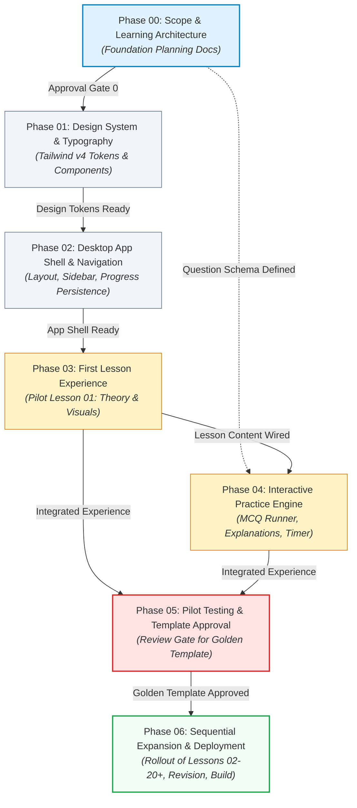

# Phase 00: Scope & Learning Architecture Specification

| Metadata | Details |
| :--- | :--- |
| **Project** | HSA EnglishMaster |
| **Document ID** | `docs/phase-00-scope.md` |
| **Phase** | Phase 00 (Scope and Learning Architecture) |
| **Document #** | 01 of 04 |
| **Status** | Draft |
| **Version** | 1.0.0 |
| **Date** | 2026-10-20 |
| **Target Examination** | Rajasthan High Court System Assistant (HSA) Examination |
| **Primary Authors** | System Architecture & Pedagogical Design Team |

---

## 1. Project Overview

### 1.1 App Name & Mission
**HSA EnglishMaster** is a dedicated, structured, desktop-centric web learning application engineered specifically to help candidates prepare for the English language component of the **Rajasthan High Court System Assistant (HSA)** competitive examination.

The central mission of the application is to guide aspirants from foundational grammar comprehension to rapid, error-free execution on examination day, targeting a **10 out of 10 score** in Part-B English within an 8-to-10-minute solving window.

### 1.2 Examination Context & Strategic Role
According to the official **Rajasthan High Court System Assistant Examination Scheme & Syllabus**, the competitive selection process comprises:

```
[Written Test: 100 Marks / 100 MCQs / 2 Hours / OMR Sheet]
  ├── Part-A: Computer Knowledge (80 MCQs / 80 Marks)
  └── Part-B: General Knowledge & English (20 MCQs / 20 Marks)
        ├── General Knowledge: ~10 MCQs
        └── English: ~10 MCQs
```

Key structural factors governing the exam:
- **No Negative Marking:** Every single question must be attempted on the OMR answer sheet.
- **Language Discrepancy Rule:** In case of linguistic ambiguity in technical computer questions, the English version takes legal precedence. English proficiency directly safeguards performance in Part-A.
- **Qualifying Benchmarks:** Minimum 40% for SC/ST and PH candidates; 45% for other categories in the written test.
- **High Merit Impact:** Because Part-A (Computer Knowledge) is heavily saturated among technical candidates, the 10 English questions serve as a decisive differentiator for securing top merit ranks.

### 1.3 Technical Platform & Delivery
- **Platform:** Web application optimized exclusively for desktop environments.
- **Core Stack:** React (TypeScript) paired with Tailwind CSS v4.
- **Zero-Friction Client Architecture:** Single-page application (SPA) with local browser persistence (`localStorage`), requiring zero initial backend setup, database management, or authentication hurdles.

### 1.4 Development Approach: AI-Assisted, Phased, Vibe-Coded Development
The project adopts a structured, milestone-gated development approach:
- **Phase-by-Phase Construction:** Each phase has clear entry prerequisites, verifiable artifacts, and explicit human approval gates before downstream work begins.
- **Pilot-First Prototyping:** Instead of generating large quantities of unverified or superficial lesson content upfront, the system designs, builds, tests, and refines a single pilot lesson (**Lesson 01: Tenses Architecture & Time Markers**).
- **Template Reusability:** Once Lesson 01 meets rigorous pedagogical and UI standards, its structural pattern serves as the golden template for all remaining curriculum modules.

### 1.5 Learning Paradigm: Inspired by Progressive Typing Tutors
Typing tutors (such as TypingClub or Keybr) achieve high learning efficiency through distinct design qualities:
- **Low Cognitive Overhead:** Minimalist UI that eliminates extraneous distractions and focuses visual attention on the learning surface.
- **Micro-Skill Segmentation:** Complex subjects are broken down into discrete, digestible units rather than sprawling textbook chapters.
- **Immediate Feedback Loop:** Direct, item-level reinforcement with contextual explanations right at the point of action.
- **Sequential Mastery Unlocking:** Progression requires demonstrated competence, preventing learners from skipping foundational rules.

HSA EnglishMaster applies these exact principles to competitive grammar and vocabulary learning.

---

## 2. Project Boundaries

To guarantee velocity, code maintainability, and pedagogical depth, explicit boundaries define what is strictly in scope and what is deliberately excluded.

```
+---------------------------------------------------------------------------------------+
|                                    PROJECT SCOPE                                      |
+---------------------------------------------------+-----------------------------------+
|                     IN SCOPE                      |           OUT OF SCOPE            |
+---------------------------------------------------+-----------------------------------+
|  * 10 Official English Syllabus Topics            |  * Part-A: Computer Knowledge     |
|  * 4-Stage Lesson Flow (Theory->Visual->Prac->Test) |  * General Knowledge (Rajasthan/CA)|
|  * Desktop-First Viewport (1280px+)               |  * Mobile / Responsive Adaptations|
|  * Client-Side Persistence (localStorage)         |  * Backend Server & User Accounts |
|  * Structured JSON Question Engine with Schema    |  * Payment / Monetization Systems |
|  * Provenance-Tracked Question Data               |  * Real-Time Social / Multiplayer |
|  * Pilot Lesson 01 Fully Functional               |  * Dual-Language (Hindi UI)       |
|  * Locked Placeholder System for Remaining Units  |  * Runtime Generative AI Answers  |
+---------------------------------------------------+-----------------------------------+
```

### 2.1 In Scope

1. **Curriculum Alignment (10 Official Syllabus Topics):**
   - Topic 1: Tenses / Sequences of Tenses
   - Topic 2: Voice: Active & Passive
   - Topic 3: Narration: Direct and Indirect
   - Topic 4: Transformation of Sentences (Assertive to Negative, Interrogative, Exclamatory, and vice-versa)
   - Topic 5: Use of Articles, Determiners, and Prepositions
   - Topic 6: Correction of Sentences (Subject-Verb Agreement, Degrees of Adjectives, Connectives, Words Wrongly Used)
   - Topic 7: Synonyms and Antonyms
   - Topic 8: One-Word Substitutions
   - Topic 9: Prefixes and Suffixes
   - Topic 10: Idioms & Phrases
2. **Pedagogical Progression Loop:**
   - Every active lesson implements a four-stage flow: **Theory** (core rules) $\to$ **Visual Aids** (diagrams, comparison tables, formula cards) $\to$ **Interactive Practice** (immediate feedback drills) $\to$ **Formal Assessment** (timed checkpoint quiz).
3. **Desktop-Optimized Workspace:**
   - Tailored specifically for large displays (1280px minimum width, standard 1920x1080 desktop layout).
   - Generous typographic scale, side-by-side comparative views, persistent progress sidebars, and keyboard-driven navigation.
4. **Local Data Persistence:**
   - Client-side storage via `localStorage` preserving user state, lesson completion, practice attempts, accuracy scores, and error logs across browser refreshes.
5. **Interactive Question & Practice Engine:**
   - Standardized multiple-choice questions (MCQs) with comprehensive distractors, rule citations, and analytical explanations.
6. **Pilot Lesson Strategy:**
   - Lesson 01 (*Tenses Architecture & Time Markers*) built to full production fidelity.
   - All subsequent curriculum modules represented as structured, locked placeholders displaying estimated durations, topic descriptions, and prerequisite dependencies.

### 2.2 Out of Scope

> [!IMPORTANT]
> The following capabilities are explicitly excluded from the current product specification. Any attempt to introduce these features without formal scope amendment is considered scope creep.

1. **Mobile Responsiveness:** No mobile phone or small tablet responsive reflows. The app targets desktop/laptop browsers where serious exam study takes place.
2. **Part-A (Computer Knowledge):** The 80-mark technical computing section is completely out of scope.
3. **General Knowledge Section:** Rajasthan History, Culture, Geography, and Current Affairs are excluded.
4. **Hindi Language Support:** The application interface and learning materials are delivered entirely in English. Dual-language toggles are out of scope.
5. **Backend Server, Cloud Database, and Authentication:** No user registration, passwords, cloud database synchronization, or REST/GraphQL server infrastructure.
6. **Payment Gateways & Monetization:** No subscriptions, paywalls, or commercial transaction processing.
7. **Multiplayer, Leaderboards, and Social Feeds:** No peer-to-peer competition, public user rankings, or forum comments.
8. **Runtime Generative AI Chatbots:** No real-time LLM query answering or dynamic question generation inside the client. All instructional text and questions are pre-authored, schema-validated, and verified.

---

## 3. Assumptions

The design and development of HSA EnglishMaster are guided by the following fundamental assumptions:

1. **Definitive Curriculum Baseline:** The official syllabus released by the Rajasthan High Court for the System Assistant post represents the single legal and binding curriculum boundary.
2. **Granular Lesson Decomposition:** Each of the 10 official syllabus topics cannot be effectively taught in a single lesson. Topics will be decomposed into 1 to 3 modular lessons based on grammatical breadth and syntactic difficulty (e.g., Tenses split into architecture, sequences, and conditionals).
3. **40-Day Roadmap as Pedagogical Reference:** The *HSA English 10/10 Mastery QuestMap* (40-day roadmap) provides invaluable pedagogical pacing, skill definitions, and daily task breakdowns, but is treated as an advisory instructional reference rather than an immutable statutory constraint.
4. **Decoupled Content Architecture:** All instructional theory, reference tables, and interactive questions will be authored in separate Markdown/MDX and JSON files, completely separated from React UI components, ensuring content auditability and zero-recompile content updates.
5. **Strict Question Provenance:** No practice question will be tagged or marketed as a "Previous Year Question" (PYQ) unless its source examination, year, and conducting agency (e.g., *RHC LDC 2022*, *RSMSSB CET 2023*) have been verified. Original questions will be clearly designated as original drill items.
6. **Learner Baseline Persona:** The intended learner possesses basic English literacy (understanding everyday English vocabulary and basic sentence construction) but lacks confidence in competitive grammar rules, exception traps, and timed MCQ elimination strategies.
7. **Standard Desktop Viewport:** Target users study on laptop or desktop monitors with an effective viewport width of $\ge 1280\text{px}$. Layouts are optimized for wide aspect ratios with dual-pane or tri-pane density.

---

## 4. Non-Goals

To keep development focused on core value, the following items are established as explicit non-goals:

- **Not a General English Learning / ESL System:** The platform does not teach conversational English, accent training, business correspondence, or creative writing. It is an exam-targeting score accelerator.
- **Not a Standalone Mock Test Platform:** While checkpoint assessments and timed drills are integral to the learning cycle, the app is not designed to replace 100-question full-length multi-subject mock examination portals.
- **Not a Replacement for Live Faculty Coaching:** The app does not provide live video streams or 1-on-1 tutoring sessions. It is a self-directed mastery workbench.
- **No Score Guarantee Warranty:** While the curriculum is engineered for a 10/10 outcome, the system cannot legally guarantee examination performance, which depends on candidate discipline and exam-day execution.
- **No Real-Time Social Collaboration:** Learners work independently. There are no study groups, shared notes, or user messaging systems.
- **No Dynamically Generated Questions:** The practice engine will not prompt an LLM at runtime to invent questions on the fly. Dynamic question generation poses high hallucination risks in competitive grammar rules.

---

## 5. Key Decisions Made in Phase 00

The preliminary architectural phase has established seven binding structural decisions:

### Decision 1: Content Separation (MDX & JSON Data Contracts)
- **Rationale:** Hardcoding instructional text or practice questions inside React JSX creates brittle code, complicates review by non-technical grammar experts, and inflates bundle sizes.
- **Implementation:** Theory lessons reside in Markdown/MDX files. Practice questions reside in structured, schema-validated JSON files. React components consume this data strictly via typed interface props.

### Decision 2: Standardized Question Schema with Provenance Tracking
- **Rationale:** Grammar questions require rigorous classification by difficulty, topic taxonomy, specific grammar rule ID, and provenance to prevent inaccurate content.
- **Implementation:** Every question follows a strict JSON schema including `id`, `topicId`, `subtopic`, `stem`, `options`, `correctIndex`, `explanation`, `ruleReference`, `difficulty` (`Easy` | `Medium` | `Hard`), and `provenance` (`Original` | `Verified_PYQ` | `Adapted`).

### Decision 3: Zero-Backend Client Persistence (`localStorage`)
- **Rationale:** Eliminating backend servers, APIs, and authentication databases removes operational costs, latency, and deployment friction.
- **Implementation:** A reactive state manager (Zustand or React Context) synchronizes progress, completed stages, drill scores, and flagged mistakes directly with browser `localStorage`. Schema versioning guarantees safe state migrations.

### Decision 4: Four-Stage Lesson Pedagogical Loop
- **Rationale:** Passive reading does not produce test-taking accuracy. Candidates need structured progression from conceptual theory to active recall.
- **Implementation:** Every lesson follows an enforced sequence:
  1. *Stage 1: Theory* — Clear structural rules and formula definitions.
  2. *Stage 2: Visual Aids* — Comparison matrices, timeline graphics, and "Safe-Zone" exception callouts.
  3. *Stage 3: Guided Practice* — Untimed interactive drills with instant explanation feedback.
  4. *Stage 4: Milestone Assessment* — Timed scoring quiz enforcing passing benchmarks.

### Decision 5: Pilot Lesson Selection (Lesson 01: Tenses Architecture & Time Markers)
- **Rationale:** Tenses form the syntactic cornerstone for all subsequent grammar topics (Voice, Narration, Conditionals, and Sentence Correction). Validating Lesson 01 establishes the component library, state flow, and design language for the rest of the app.
- **Implementation:** Lesson 01 is developed to 100% completion during Phase 03. Lessons 02 through 20+ remain visibly structured but locked.

### Decision 6: Demonstrative Mastery Policy
- **Rationale:** Passing a quiz once via guessing does not equate to grammar mastery.
- **Implementation:** Mastery is evaluated across multiple factors: completing theory stages, achieving $\ge 80\%$ on the timed milestone test, and successfully resolving questions logged in the candidate's personal Error Log.

### Decision 7: Verification Standard for Syllabus & Exam Information
- **Rationale:** Secondary coaching notes frequently introduce unauthorized syllabus interpretations or unverified previous-year claims.
- **Implementation:** Any rule, topic, or claim directly extracted from the official High Court PDF is flagged as `[VERIFIED: OFFICIAL SYLLABUS]`. Pedagogical suggestions from the 40-day roadmap are flagged as `[ROADMAP PROPOSAL]`.

---

## 6. Phase Dependencies & Execution Roadmap

The project is structured into seven sequential phases. Each phase represents a distinct milestone with clear inputs, outputs, and review gates.

### 6.1 Phase Dependency Graph



### 6.2 Phase Detail & Gating Matrix

| Phase | Phase Name | Primary Dependencies | Deliverables & Artifacts | Exit / Approval Gate |
| :--- | :--- | :--- | :--- | :--- |
| **00** | **Scope & Learning Architecture** | Official Syllabus PDF, HSA English Roadmap PDF | `phase-00-scope.md`<br>`syllabus-mapping.md`<br>`learning-architecture.md`<br>`technical-architecture.md` | Formal sign-off on scope boundaries, syllabus mapping, and schema definitions. |
| **01** | **Design System & Typography** | Phase 00 Approval | Tailwind v4 configuration, color tokens, typography scale, atom components (Buttons, Badges, Callout cards). | Visual review of UI kit, accessibility audit for contrast, desktop typography check. |
| **02** | **Desktop App Shell & Navigation** | Phase 01 Design System | Multi-pane desktop layout, collapsible sidebar, topic quest map, breadcrumb system, localStorage hook. | Shell renders stably at 1280px+, navigation between views works smoothly, progress state persists across page reload. |
| **03** | **First Lesson Experience** | Phase 02 App Shell, Phase 01 Design System, `lesson-01-spec.md` | Lesson 01 content authored (Theory, Time Markers matrix, Visual Formula cards, Safe-Zone alerts). | Pilot Lesson 01 theory and visual aids fully readable, styled, and navigable. |
| **04** | **Interactive Practice Engine** | Phase 03 Lesson Shell, Phase 00 Question Schema | Interactive MCQ runner, option selection state, immediate feedback drawer, score calculator, timer. | Candidate can complete a 15-question drill, receive instant rule-based explanations, and view summary. |
| **05** | **Pilot Testing & Reusable Template** | Phase 03 & Phase 04 Complete | End-to-end integration test of Lesson 01, bug fixes, candidate experience audit, `lesson-template.md`. | **Critical Gate:** Explicit human verification that Lesson 01 represents the required standard for content and code. |
| **06** | **Expansion, Revision & Deployment** | Phase 05 Approved Template | Authoring Lessons 02–20+, Error Log revision engine, timed milestone mocks, final build & deployment. | All 10 syllabus topics populated, end-to-end test pass, production build verification. |

---

## 7. Risk Register

The following register identifies anticipated risks, assesses their potential severity, and specifies preventive and corrective mitigations:

| Risk ID | Risk Description | Likelihood | Impact | Mitigation Strategy | Owner |
| :---: | :--- | :---: | :---: | :--- | :---: |
| **RSK-01** | **Content Accuracy & Grammar Errors:** Minor typographical or grammatical errors in theory rules or answer keys instantly undermine user trust. | Medium | Critical | All lesson rules and answer keys must be cross-referenced against authoritative standard grammars (Wren & Martin, Nesfield) and official answer keys. No automated bulk generation without line-by-line review. | Pedagogical Author |
| **RSK-02** | **Scope Creep & Feature Bloat:** Urge to implement backend accounts, mobile layouts, audio pronunciation, or Part-A computer content before shipping the core English learning engine. | High | High | Strict adherence to Phase Boundaries (Section 2). Any request outside desktop English learning is systematically deferred to post-Phase 06 backlogs. | Project Lead |
| **RSK-03** | **Over-Engineering Architecture:** Building heavy abstractions, complex micro-frontends, or cloud databases for an initial single-user client application. | Medium | Medium | Mandate zero-backend architecture. Use native React state, TypeScript interfaces, and `localStorage`. Keep dependencies minimal. | Tech Lead |
| **RSK-04** | **Content Authoring Bottleneck:** Writing comprehensive theory, comparison tables, and 30+ high-quality questions per lesson across 20+ lessons requires immense authored volume. | High | High | Phase 05 isolates a standardized reusable authoring template. Phased rollout ensures pilot Lesson 01 is perfected first before scaling content authoring. | Pedagogical Author |
| **RSK-05** | **Verification Gap on Exam Claims:** Mistaking unverified coaching claims or internet question sets for genuine Rajasthan High Court PYQs. | High | Medium | Strict provenance tracking metadata (`Original`, `Verified_PYQ`, `Adapted`). Unverified questions are forbidden from claiming PYQ status in the UI. | Research Lead |
| **RSK-06** | **State Corruption / Schema Drift:** Updates to localStorage data structures breaking existing user progress records during updates. | Low | Medium | Implement defensive state versioning and migration fallbacks in the persistence manager (`localStorage` schema migration guard). | Frontend Lead |
| **RSK-07** | **Visual Fatigue on Desktop:** Dense text-heavy layouts causing learner disengagement or cognitive exhaustion. | Medium | Medium | Typing-tutor style progressive chunking: cards, high-contrast syntax highlighting, formula visual chips, and interactive accordion reveals. | UI/UX Designer |

---

## 8. Success Criteria for Phase 00

Phase 00 is considered complete and approved when the following tangible deliverables have been authored, peer-reviewed, and verified against project goals:

- [x] **Planning Deliverable 1 (`phase-00-scope.md`):** Complete document defining project boundaries, scope inclusions/exclusions, non-goals, architectural decisions, phase dependencies, risk register, and approval gates.
- [ ] **Planning Deliverable 2 (`syllabus-mapping.md`):** Complete comparative matrix mapping all 10 official Rajasthan High Court English syllabus topics against the 40-Day Roadmap tasks, tagging each item with verified provenance flags.
- [ ] **Planning Deliverable 3 (`learning-architecture.md`):** Comprehensive pedagogical blueprint specifying the 4-stage learning loop, mastery progression algorithms, error log remediation framework, and the standardized JSON practice question schema.
- [ ] **Planning Deliverable 4 (`technical-architecture.md`):** Complete architectural and system specification outlining React + TypeScript structure, Tailwind CSS v4 design tokens, client-side persistence contracts, component hierarchy, and bundle strategies.
- [ ] **Pilot Lesson 01 Bounded Scope:** Clear pedagogical and technical specification for Lesson 01 (*Tenses Architecture & Time Markers*) ready for execution in Phase 03.
- [ ] **Phase 00 Approval Gate Sign-off:** Formal sign-off and consensus among stakeholders to proceed to Phase 01 (Design System & Typography).
