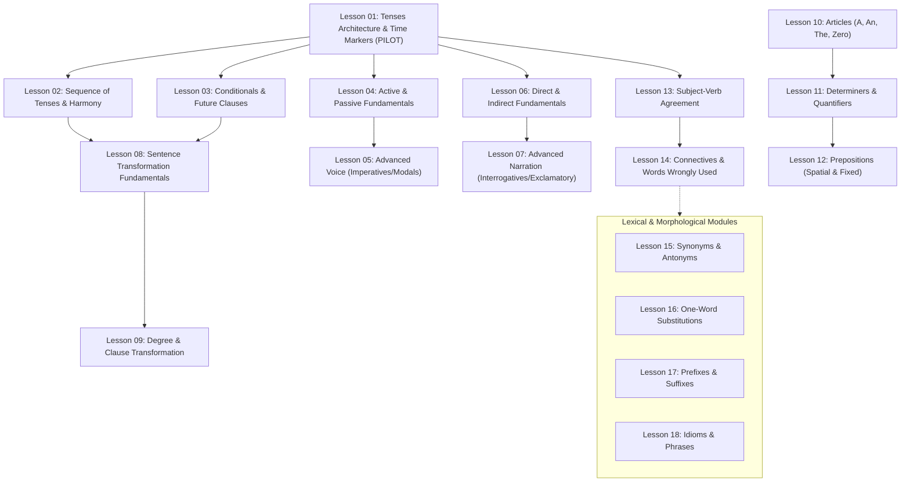

# Syllabus Mapping & Curriculum Architecture

> **Document Identifier:** `HSA-DOC-002`  
> **Phase:** Phase 00 (Planning & Architecture) — Document #2  
> **Status:** Draft  
> **Date:** October 20, 2026  
> **Target Project:** HSA English Learning App (Rajasthan High Court System Assistant Exam)  
> **Document Role:** Official syllabus audit, lesson decomposition, supplemental topic classification, and pedagogical scope mapping.

---

## 1. Executive Summary

This document establishes the official curricular baseline for the **HSA English Learning App**. It maps every officially prescribed English topic from the Rajasthan High Court System Assistant competitive examination syllabus to a modular, 18-lesson curriculum architecture. 

To maintain strict academic integrity and engineering clarity, this document rigorously distinguishes between **officially mandated examination topics** (verified verbatim against the official notification) and **supplemental pedagogical extensions** introduced by study roadmaps or instructional design recommendations.

---

## 2. Source Documents & Authority Hierarchy

The curriculum design is informed by two distinct source documents with different levels of authority:

| Document Attribute | Primary Source Document | Secondary Reference Document |
| :--- | :--- | :--- |
| **File Name** | `Rajasthan High Court System Assistant Syllabus.pdf` | `HSA_English.pdf` |
| **Document Title** | *Scheme & Syllabus of Examination for the Post of System Assistant* | *40-Day English Preparation Strategy & Roadmap* |
| **Origin / Authority** | **Official Examination Authority** (Rajasthan High Court, Jodhpur) | **Pedagogical Reference / Study Guide** (Secondary) |
| **Curricular Status** | **Binding & Mandated** | **Advisory & Supplemental** |
| **Document Scope** | Defines Part-B Written Test structure, section breakdown (Computer Knowledge 80 marks, GK & English 20 marks), and verbatim English syllabus topics. | Proposes a 40-day, 6-week daily study schedule, learning heuristics, OMR exam tactics, and study strategies. |
| **Role in Development** | Serves as the sole authoritative source for scope, topic validation, and boundary conditions. All core content must map directly here. | Serves as an instructional design reference for topic sequencing, depth recommendations, sub-topics, and mnemonic patterns. |

---

## 3. Official Syllabus Topics Mapping

In the official notification under **Part-B General Knowledge & English (Section-A Written Test)**, subsection **(b) English** contains exactly **10 verbatim topics**. No other topics are legally or officially prescribed.

The following master table defines the full mapping of these 10 topics to the proposed 18-lesson modular structure:

| # | Official Syllabus Topic (Verbatim) | Official Source | Verification Status | Proposed Lesson(s) | Estimated Complexity |
| :-: | :--- | :--- | :-: | :--- | :-: |
| **1** | **Tenses/Sequences of Tenses** | Official Syllabus PDF, Page 2–3 | ✅ Verified | **Lesson 01:** Tenses Architecture & Time Markers<br>**Lesson 02:** Sequence of Tenses & Tense Harmony<br>**Lesson 03:** Conditional Sentences & Future Time Clauses | **High** |
| **2** | **Voice: Active & Passive** | Official Syllabus PDF, Page 2–3 | ✅ Verified | **Lesson 04:** Active & Passive Voice Fundamentals<br>**Lesson 05:** Advanced Voice — Imperatives, Modals & Prepositional Verbs | **Medium-High** |
| **3** | **Narration: Direct and Indirect** | Official Syllabus PDF, Page 2–3 | ✅ Verified | **Lesson 06:** Direct & Indirect Speech — Fundamentals<br>**Lesson 07:** Advanced Narration — Interrogatives, Imperatives & Exclamatory | **Medium-High** |
| **4** | **Transformation of Sentences: Assertive to Negative, Interrogative, Exclamatory and vice-versa** | Official Syllabus PDF, Page 2–3 | ✅ Verified | **Lesson 08:** Sentence Transformation — Assertive, Negative, Interrogative, Exclamatory<br>**Lesson 09:** Degree Transformations & Too…to / So…that Conversions | **Medium** |
| **5** | **Use of Articles, Determiners and Prepositions** | Official Syllabus PDF, Page 2–3 | ✅ Verified | **Lesson 10:** Articles — A/An, The & Zero Article Rules<br>**Lesson 11:** Determiners & Quantifiers (Little/Few Architecture)<br>**Lesson 12:** Prepositions — Time, Place, Movement & Fixed Prepositions | **Medium-High** |
| **6** | **Correction of sentences including subject, verb, Agreement, Degrees of Adjectives, Connectives and words wrongly used** | Official Syllabus PDF, Page 2–3 | ✅ Verified | **Lesson 13:** Subject-Verb Agreement & Error Architecture<br>**Lesson 14:** Connectives, Modifiers & Words Wrongly Used | **High** |
| **7** | **Synonyms and Antonyms** | Official Syllabus PDF, Page 3 | ✅ Verified | **Lesson 15:** Synonyms & Antonyms (Core High-Frequency & Administrative Vocabulary) | **Medium** |
| **8** | **One-word substitutions** | Official Syllabus PDF, Page 3 | ✅ Verified | **Lesson 16:** One-Word Substitutions (Root Words & Administrative Terms) | **Low-Medium** |
| **9** | **Prefixes and Suffixes** | Official Syllabus PDF, Page 3 | ✅ Verified | **Lesson 17:** Prefixes & Suffixes — Morphological Word Formation | **Low-Medium** |
| **10** | **Idioms & Phrases** | Official Syllabus PDF, Page 3 | ✅ Verified | **Lesson 18:** Idioms & Phrases (Contextual Usage & Common Traps) | **Medium** |

**Total Proposed Curriculum Scope:** **18 Modular Lessons**

---

### Detailed Decomposition of Proposed Lessons

#### Topic 1: Tenses/Sequences of Tenses (Lessons 01–03)
* **Lesson 01: Tenses Architecture & Time Markers**  
  * *Scope:* 12 grammatical tense structures; verb inflection system ($V_1$, $V_2$, $V_3$, $V_4$, $V_5$); auxiliary verbs (`do/does/did`, `is/am/are/was/were`, `has/have/had`); explicit temporal markers (`already`, `yet`, `since/for`, `by the time`, `ago`, `recently`).  
  * *Target Skill:* Structural identification, auxiliary-verb concord, error-spotting in time-adverb concord.
* **Lesson 02: Sequence of Tenses & Tense Harmony**  
  * *Scope:* Tense coordination across complex sentences; main clause in past inducing subordinate clause backshifting; universal truth and habitual fact exceptions; temporal clause restrictions.  
  * *Target Skill:* Identifying cross-clause tense distortion in multi-clause sentences.
* **Lesson 03: Conditional Sentences & Future Time Clauses**  
  * *Scope:* Zero, First, Second, Third, and Mixed conditionals; modal auxiliaries in result clauses (`would`, `could`, `might`); inverted conditionals (`Had I known...`, `Were he to...`); temporal conjunctions (`when`, `until`, `as soon as`).  
  * *Target Skill:* Error detection in if-clause/main-clause verb pairing.

#### Topic 2: Voice: Active & Passive (Lessons 04–05)
* **Lesson 04: Active & Passive Voice Fundamentals**  
  * *Scope:* Subject-object transposition; agentive `by`-phrases; systematic auxiliary expansion (`be` + $V_3$); tense-by-tense transformation matrix (simple, continuous, perfect); tenses that resist standard passive transformation.  
  * *Target Skill:* Rapid active-to-passive conversion and reverse transformation.
* **Lesson 05: Advanced Voice — Imperatives, Modals & Prepositional Verbs**  
  * *Scope:* Imperative orders, requests, and advice (`Let + object + be + V3`, `You are requested to...`); passive with modals (`modal + be + V3`); ditransitive verbs (direct vs. indirect object priority); phrasal verbs and retained prepositions (`laughed at`, `looked after`).  
  * *Target Skill:* Handling complex non-canonical passive forms found in competitive exams.

#### Topic 3: Narration: Direct and Indirect (Lessons 06–07)
* **Lesson 06: Direct & Indirect Speech — Fundamentals**  
  * *Scope:* Reporting verb transformations (`said to` $\to$ `told`); pronoun shifts (first, second, third person rules via SON formula); tense backshifting matrix; deictic adverbial shifts (time and place: `now` $\to$ `then`, `here` $\to$ `there`, `tomorrow` $\to$ `the following day`).  
  * *Target Skill:* Accurate conversion of assertive declarative statements without shift omissions.
* **Lesson 07: Advanced Narration — Interrogatives, Imperatives & Exclamatory**  
  * *Scope:* Wh-questions vs. Yes/No questions (use of `if` / `whether`); command and request conversions (infinitive clause embedding); exclamations and wishes (`exclaimed with joy/sorrow`, optative sentences); reporting clauses with past vs. present reporting verbs.  
  * *Target Skill:* Flawless punctuation elimination and non-declarative reporting structure conversions.

#### Topic 4: Transformation of Sentences (Lessons 08–09)
* **Lesson 08: Sentence Transformation — Assertive, Negative, Interrogative, Exclamatory**  
  * *Scope:* Structural mutations without alteration of underlying semantic meaning; double negatives; rhetorical questions to assertives; exclamatory to emphatic assertives; interchange of affirmative and negative syntax.  
  * *Target Skill:* Selecting semantically equivalent transformations while strictly avoiding meaning shifts.
* **Lesson 09: Degree Transformations & Too…to / So…that Conversions**  
  * *Scope:* Interchange of degrees of comparison (positive, comparative, superlative using `as...as`, `than`, `the most`); causal result clause conversion (`too + adj + to-infinitive` $\leftrightarrow$ `so + adj + that + cannot`); `no sooner...than` vs. `as soon as`.  
  * *Target Skill:* Master syntactic restructurings commonly tested in state competitive formats.

#### Topic 5: Use of Articles, Determiners and Prepositions (Lessons 10–12)
* **Lesson 10: Articles — A/An, The & Zero Article Rules**  
  * *Scope:* Phonetic conditioning of indefinite articles (`a` vs. `an` based on initial vowel phoneme, e.g., `an honest`, `a university`); definite article specifics (unique entities, geographical features, ordinal numbers, superlatives); zero article environments (uncountable nouns, languages, meals, abstract nouns, academic subjects).  
  * *Target Skill:* Eliminating redundant article insertions and correcting omission defects.
* **Lesson 11: Determiners & Quantifiers (Little/Few Architecture)**  
  * *Scope:* Countable vs. uncountable determiners; precision architecture of `few / a few / the few` vs. `little / a little / the little`; distributive determiners (`each`, `every`, `either`, `neither`); quantifiers (`some`, `any`, `much`, `many`).  
  * *Target Skill:* Resolving nuanced quantifier selections in constrained contexts.
* **Lesson 12: Prepositions — Time, Place, Movement & Fixed Prepositions**  
  * *Scope:* Spatial prepositions (`in`, `at`, `on`); temporal markers (`since`, `for`, `during`, `by`); directional movement (`into`, `onto`, `across`, `through`); high-yield fixed preposition regimes (`congruent with`, `abstain from`, `accede to`, `comply with`).  
  * *Target Skill:* Mastery over high-frequency fixed prepositions and contextual spatial markers.

#### Topic 6: Correction of Sentences (Lessons 13–14)
* **Lesson 13: Subject-Verb Agreement & Error Architecture**  
  * *Scope:* Proximity vs. true head noun agreement; compound subjects joined by `and`, `or`, `nor`, `as well as`, `along with`, `together with`; indefinite pronouns (`everybody`, `none`, `each`); collective nouns; measurement and money units; inverted sentence structures (`Here comes...`).  
  * *Target Skill:* Rapid head-noun isolation and concord error spotting.
* **Lesson 14: Connectives, Modifiers & Words Wrongly Used**  
  * *Scope:* Correlative conjunction pairs (`either...or`, `neither...nor`, `not only...but also`, `scarcely...when`, `hardly...when`); dangling and misplaced modifiers; homophones and commonly confused lexemes (`affect/effect`, `compliment/complement`, `principle/principal`, `stationery/stationary`).  
  * *Target Skill:* Comprehensive multi-point sentence verification and spotting disguised semantic errors.

#### Topics 7–10: Vocabulary & Morphological Systems (Lessons 15–18)
* **Lesson 15: Synonyms & Antonyms**  
  * *Scope:* High-frequency competitive examination vocabulary; secondary semantic nuances; context-dependent valence (connotation); legal and official administrative lexical terms.  
  * *Target Skill:* Rapid elimination of near-synonyms and selection of optimal antonymic pairs.
* **Lesson 16: One-Word Substitutions**  
  * *Scope:* Lexical compression; Greek and Latin morphological root networks (`-cide`, `-phobia`, `-cracy`, `-phil-`, `omni-`, `pan-`); professional designations, governance terminology, and official administrative descriptors.  
  * *Target Skill:* Rapid recognition of multi-word concept abstractions.
* **Lesson 17: Prefixes & Suffixes — Word Formation**  
  * *Scope:* Derivational prefixes (negation: `un-`, `in-`, `dis-`, `mis-`; directional/quantitative: `ante-`, `post-`, `hyper-`, `sub-`); part-of-speech conversion suffixes (nominalizers: `-tion`, `-ment`, `-ity`; adjectival: `-able`, `-ous`, `-ful`; verbalizers: `-ize`, `-en`).  
  * *Target Skill:* Accurate derivation of lexical variants and detection of erroneous affixes.
* **Lesson 18: Idioms & Phrases**  
  * *Scope:* High-yield figurative expressions; idioms derived from body parts, animals, and classical roots; common legal, bureaucratic, and workplace idioms; literal-interpretation trap recognition.  
  * *Target Skill:* Contextual decoding and avoidance of deceptive literal distractors.

---

## 4. Supplemental Concepts & Pedagogical Extensions

The secondary document (`HSA_English.pdf`) introduces numerous concepts, heuristic strategies, and sub-topics not explicitly articulated in the official high court syllabus. 

To ensure curricular transparency, these elements are audited and categorized below into **Curricular Extensions** (incorporated with pedagogical justification) and **Out-of-Scope Elements** (excluded from subject-matter content):

| Concept / Strategy | Source Document | Status Classification | Curricular Rationale & Treatment | Mapped Location |
| :--- | :--- | :---: | :--- | :--- |
| **Conditional Sentences (Types 0–3)** | `HSA_English.pdf` (Week 1–2 Roadmap) | ⚠️ **Supplemental (In-Scope)** | Conditionals are universally treated in competitive English examinations as an integral subset of *Tenses/Sequences of Tenses* due to their strict if-clause/result-clause auxiliary harmony. Valid curricular extension. | **Lesson 03** *(Tenses & Conditionals)* |
| **Fixed / Administrative Prepositions** | `HSA_English.pdf` (Week 3 Roadmap) | ⚠️ **Supplemental (In-Scope)** | The official syllabus mandates "Use of Prepositions". Fixed prepositional collocations (`abide by`, `prohibit from`) are the standard format for competitive test items under this topic. | **Lesson 12** *(Prepositions)* |
| **Legal & Administrative Vocabulary** | `HSA_English.pdf` (Week 5 Roadmap) | ⚠️ **Supplemental (In-Scope)** | While not partitioned as an isolated topic in the syllabus, contextualizing synonyms, antonyms, and substitutions within High Court/Judicial administrative domains optimizes practical test relevance. | **Lesson 15 & 16** *(Context Examples)* |
| **Confusing Word Pairs (Homophones)** | `HSA_English.pdf` (Week 5 Roadmap) | ⚠️ **Supplemental (In-Scope)** | The official syllabus explicitly includes "words wrongly used" under Sentence Correction. Pair distinction is essential to diagnose these errors. | **Lesson 14** *(Connectives & Words Wrongly Used)* |
| **OMR Answering Strategies** | `HSA_English.pdf` (Phase 4 / Mock Strategy) | ❌ **Out of Content Scope** | OMR filling techniques (bubble shading, time-allocation heuristics) are general test-taking strategies, not language curriculum content. | *Excluded from lesson content; may live in UI onboarding/exam tips modal.* |
| **Spaced Repetition Framework (1-3-7-15 Day)** | `HSA_English.pdf` (Intro Strategy) | ❌ **Out of Content Scope** | Spaced repetition is a cognitive study methodology and application software feature, not a syllabus topic. | *Implemented via App SRS revision engine, not a content lesson.* |
| **3-Step Solving Technique (Elimination)** | `HSA_English.pdf` (Grammar Strategy) | ❌ **Out of Content Scope** | General heuristic protocol for MCQ elimination; pedagogical UI design pattern rather than academic lesson content. | *Embedded into practice UI feedback/hints, not taught as grammar theory.* |

---

## 5. Verification Notes & Authenticity Boundaries

To uphold software quality and factual integrity, all development and content teams must adhere to the following strict boundaries:

### What CAN Be Verified from Official Sources
1. **Verbatim English Syllabus:** The official syllabus contains exactly the 10 topics enumerated in Section 3, listed under Part-B of the Written Test.
2. **Examination Weightage:** The Written Test comprises 100 marks total (Part-A Computer Knowledge: 80 marks; Part-B General Knowledge & English: 20 marks total).
3. **Examination Scheme:** The written examination is a single paper of 2 hours duration, conducted via OMR answer sheets, with **no negative marking** for incorrect answers.
4. **Pedagogical Roadmap Feasibility:** The secondary document (`HSA_English.pdf`) provides a viable 40-day pacing structure, but its chapter divisions are pedagogical recommendations rather than statutory syllabus mandates.

### What CANNOT Be Verified from the Supplied Documents
1. **English vs. GK Partitioning:** The official syllabus does not specify the exact split of the 20 Part-B marks between General Knowledge and English (e.g., whether it is 10/10, 12/8, or variable).
2. **Per-Topic Weightage:** No official document guarantees a specific question distribution across the 10 English topics (e.g., how many questions will come from Tenses vs. Voice vs. Vocabulary).
3. **Historical Cutoffs & Trends:** Previous year question (PYQ) patterns, statistical topic frequency, and category-specific score distributions are not provided in the primary syllabus notification.
4. **Official Language Precedence / Discrepancy Rule:** The supplied official syllabus PDF does not establish the asserted official English-language precedence rule. While frequently referenced in coaching roadmaps, it is not established by the official notification.
5. **Sectional Time Limits:** The official written examination is a single 2-hour paper (120 minutes) across all 100 questions. Sectional pacing targets (such as completing English in 8–10 minutes) are candidate preparation strategies, not statutory examination limits.

### Strict Question Labeling Policy
> [!IMPORTANT]
> **Zero-Tolerance Policy on Question Provenance:**  
> No question, practice prompt, or quiz item within the HSA English Learning App shall be labeled as a **"Previous Year Question" (PYQ)**, **"Official High Court Past Item"**, or **"Exam Memory Question"** unless the engineering and content team has an authenticated, officially published question paper source with verifiable exam year, tier, and question number citations. All unverified items must be transparently designated as **"Curriculum Practice Item"** or **"Mock Exam Question"**.

### Design Nature of the 18-Lesson Architecture
> [!NOTE]
> The division into **18 distinct lessons** is an instructional systems design (ISD) decision tailored to optimize cognitive load, visual presentation, and mastery tracking. The Rajasthan High Court syllabus does not mandate 18 lessons or any specific lesson numbering; it lists 10 broad academic subject headings.

---

## 6. Pilot Lesson Selection Rationale: Lesson 01

For Phase 01 development and the initial pilot implementation, **Lesson 01: Tenses Architecture & Time Markers** is deliberately selected based on four core criteria:

```
[Curriculum Priority] ──► Top item in official High Court syllabus (Topic #1)
[Syntactic Dependency] ──► Prerequisite foundation for Voice, Narration & Agreement
[Architecture Stress]  ──► Exercises all app features (Rules, Timelines, MCQs, Hints)
[Disciplined Scope]    ──► Strictly bounded to 12 tenses & markers (avoids bloat)
```

1. **Top-Level Syllabus Primacy:**  
   "Tenses/Sequences of Tenses" is the very first topic listed under English in the official High Court syllabus. Initiating development with Topic 1 establishes a clear, logical correspondence with the candidate's expectations.

2. **Universal Syntactic Prerequisite:**  
   Tense mastery is structurally foundational. Subsequent curriculum modules cannot function without it:
   * **Voice (Lessons 04–05):** Requires immediate recognition of auxiliary-verb pairings across all 12 tenses.
   * **Narration (Lessons 06–07):** Fundamentally depends on understanding tense backshifting rules.
   * **Sentence Correction (Lessons 13–14):** Demands immediate identification of tense-marker dissonance and auxiliary discord.

3. **Complete Architectural Testbed:**  
   Lesson 01 possesses the structural depth necessary to calibrate every feature of the app's learning engine:
   * *Conceptual Explanations:* Verb conjugation paradigms ($V_1$ through $V_5$).
   * *Visual Diagramming:* Interactive tense timelines and temporal marker matrices.
   * *Rule Modules:* Auxiliary distribution algorithms (`do` vs. `does`, `has` vs. `have`).
   * *Formative Assessment:* Targeted MCQ error-spotting, time-marker fill-ins, and diagnostic feedback loops.

4. **Carefully Controlled Scope Boundary:**  
   Rather than attempting to swallow the entire expansive "Tenses/Sequences of Tenses" subject in a single monolithic lesson, Lesson 01 is intentionally bounded to the **core 12 tense structures, auxiliary rules, and explicit time markers**. Sequence of tenses and conditional structures are isolated into Lessons 02 and 03. This enables rigorous validation of instructional depth before scaling the remaining 17 lessons.

---

## 7. Curriculum Dependency Graph

The following directed flowchart maps the prerequisite relationships across the 18 proposed lessons, highlighting the foundational role of Lesson 01:



---

## 8. Document Approvals & Audit Trail

| Revision | Date | Author / Role | Summary of Changes |
| :---: | :---: | :---: | :--- |
| `v0.1.0` | 2026-10-20 | Curriculum Architect Subagent | Initial draft mapping 10 official syllabus topics to 18-lesson curriculum architecture, auditing secondary roadmap concepts, and defining Pilot Lesson 01 rationale. |
